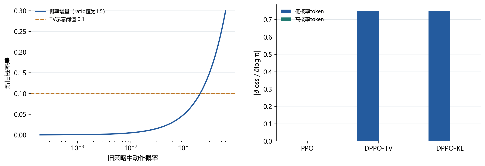
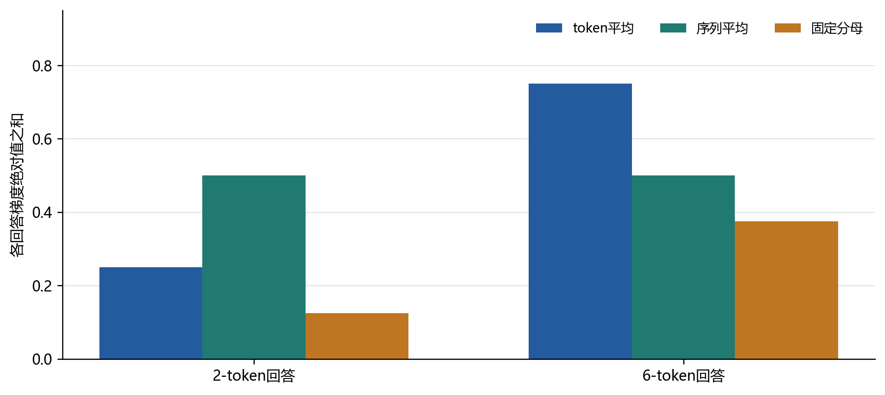
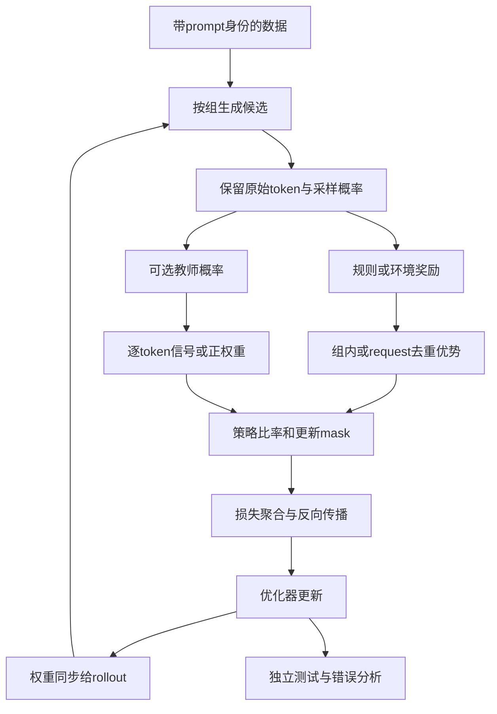

# 大语言模型后训练演进与强化学习代码研究 附件

## A 研究材料与版本

本附件固定报告使用的仓库版本，完整清单见 research/sources.json。仓库代码采用浅克隆和 sparse checkout，提交哈希是本研究的代码边界。

| 仓库 | 提交哈希 | 重点路径 |
| --- | --- | --- |
| Hugging Face TRL | d115286bc5aef8d346e8510bfe312803c7881c4a | trl/trainer/dpo_trainer.py；trl/trainer/grpo_trainer.py |
| verl | 81464bb6d35cbb43962be42b0088a591e7020f21 | verl/trainer/ppo/core_algos.py；verl/trainer/ppo/ray_trainer.py；verl/workers/utils/losses.py |
| ms-swift | a8dccaafe9324a5d454c44703e3dce92370f5c1c | swift/rl_core/advantage.py；swift/rlhf_trainers/grpo_trainer.py；swift/rlhf_trainers/rollout_mixin.py |

## B 关键代码链

| 任务 | 代码位置 | 对应关系 |
| --- | --- | --- |
| DPO参考概率 | trl/trainer/dpo_trainer.py:1237 | _precompute_ref_logps 缓存 chosen/rejected 参考 log-prob |
| DPO损失 | trl/trainer/dpo_trainer.py:1354 | _compute_loss 计算策略与参考 log-ratio 并选择 loss_type |
| GRPO生成奖励 | trl/trainer/grpo_trainer.py:2450 | _generate_and_score_completions 生成回答并调用 reward funcs |
| GRPO策略损失 | trl/trainer/grpo_trainer.py:3162 | _compute_loss 应用裁剪、KL 和 aggregation |
| verl训练主循环 | verl/trainer/ppo/ray_trainer.py:1407 | fit 串起 DataProto、rollout、reward、advantage 和 actor 更新 |
| verl优势 | verl/trainer/ppo/core_algos.py:268 | GRPO 组内均值和 std；开关形成 Dr.GRPO 式信号 |
| verl GSPO | verl/trainer/ppo/core_algos.py:1546 | 序列 log-ratio 平均、detach 广播和序列级裁剪 |
| verl DPPO | verl/trainer/ppo/core_algos.py:1380/1461 | Binary-TV/KL 散度 mask 与截断比率 |
| ms-swift优势 | swift/rl_core/advantage.py:20/102 | 固定组与 request-aware 动态组优势 |
| ms-swift损失 | swift/rlhf_trainers/grpo_trainer.py:931 | rollout correction、teacher signal 和 GRPO loss |
| 实际反传 | verl/workers/engine/base.py:113 | train_batch 调用 forward_backward_batch 与 optimizer_step |

## C 机制验证

运行命令：

    python research/scripts/mechanism_lab.py

环境为 Python 3.11、PyTorch 2.5.1+cpu、CPU、float64、seed=7。脚本从固定仓库文件提取原函数体，记录函数行号和源文件 SHA256，结果写入 research/results/mechanism_lab.json。

17 项检查全部通过：

| 检查类别 | 主要结果 |
| --- | --- |
| GRPO分组 | verl 与 ms-swift 的优势约为 +0.7071/-0.7071；交错重排时 UID 分组保持，连续分组改变 |
| 零方差 | 同一 prompt 的回答奖励完全相同时，优势为零 |
| loss聚合 | token mean、sequence mean、固定分母产生不同样本梯度权重 |
| GSPO反传 | 逐 token 优势为 [1,-1] 时，两个目标前向值均为零，但梯度分别为 [0,0] 与 [-0.5,0.5] |
| DPO构造反例 | 两个合法分布之间，偏好损失由0.6931降至0.5975，chosen概率由0.20降至0.15；该反例不是SGD训练轨迹 |
| 三动作策略更新 | 实际SGD的step 0到step 3，loss由0.693147降至0.691649，chosen概率由0.200000升至0.202710 |
| DPPO局部机制 | 相同 ratio 下，Binary-TV/KL mask 与 PPO 的保留行为不同 |
| 教师与多轮 | RLSD 保持优势符号；重复 request 获得同一去重优势 |

这些检查只验证纯函数、mask、detach 和一个三动作策略更新，不代表语言模型训练、推理能力或论文结果复现。

## D 图表源码

图表由 research/scripts/generate_figures.py 生成，SVG版本是可编辑矢量源码。

| 文件 | 用途 |
| --- | --- |
| 01_后训练技术演进路线.svg | 代表性方法时间线 |
| 03_三套代码执行链对照.svg | TRL、verl、ms-swift 执行链 |
| 05_损失聚合的样本权重.svg | 不同 aggregation 的梯度权重 |
| 06_相同损失不同梯度.svg | GSPO 前向与反向差异 |
| 07_概率比率与散度信赖域.svg | PPO 与 DPPO 的机制对照 |

## E 论文索引

论文版本与URL见research/references-verified.json和research/sources.json。13篇文献均核对主来源PDF。重点代码的[31个永久链接](https://github.com/Can1017/LLM-HW/blob/main/hw4/p226-posttraining/reports/%E4%BB%A3%E7%A0%81%E7%B4%A2%E5%BC%95.md)固定到本次提交，可从类与函数直接跳转到对应行。

## F 指定报告阅读记录

页码采用下载PDF的实际页序，不采用课程PPT页脚。R1、DPPO等报告存在修订版本，本次分别阅读v2和v3，不能将本文页码直接套用于最初版本。

| 报告 | 阅读位置与关键问题 | 得到的设计判断 |
| --- | --- | --- |
| InstructGPT v1 | PDF第6—9页，§3.1、§3.5；如何把示范与排序分成训练阶段 | 示范给出行为起点，排序用于训练RM，PPO再与环境交互；偏好数据不直接等于任务真值 |
| DeepSeek-V3 v2 | 第28—30、34页，§5；专家数据如何进入最终SFT | 专家SFT与RL后再筛选样本，可兼顾推理质量和表达；报告消融提示质量与输出长度存在代价 |
| DeepSeek-R1 v2 | 第2—8页，§2—3；无SFT探索与可用助手的差异 | R1-Zero实验与R1成品路线应区分；冷启动、RL、筛选SFT及后续RL解决不同缺口 |
| Qwen3 v1 | 第9—12页§4；第20—21页蒸馏比较 | 旗舰四阶段路线与小模型强到弱蒸馏不同；只有同学生起点、明确GPU投入的比较才能支持投入取舍 |
| DeepSeek-V3.2 v1 | 第5—10页，§3；专家蒸馏与混合RL怎样衔接 | 通用模型不必只按能力逐阶段串行优化；多域混合和规则/生成奖励也可用于控制干扰 |
| Kimi K2.5 v2 | 第4—6页§2—3、第8页§4.4；并行agent训练谁 | PARL冻结子agent，仅训练调度者；辅助奖励应逐渐让位于最终任务质量，防止空洞并行 |
| GLM-5 v2 | 第10—17页§3—4；长轨迹异步与能力回退 | 推理RL中的IcePop、多轮agent的TITO及最终跨阶段蒸馏分别处理不同误差来源 |

### F1 深读R1 为什么正确奖励还需要数据阶段

R1-Zero说明，在特定基础模型与可验证任务下，可以先通过规则奖励探索推理行为。但最终可用模型还要处理可读性、语言混杂、非推理任务等问题。R1路线因此加入冷启动数据，经过RL后做拒绝采样，并将推理与通用材料再次用于SFT，再执行后续RL。这里“先探索、再整理、继续探索”的迭代关系，比单独复述GRPO公式更能解释训练路线。

可迁移的判断是：如果学生没有可用的成功轨迹，单纯让其在线采样不一定产生新信息；应先改善示范或教师覆盖。相反，如果已有候选里包含正确解而选择不稳，偏好或结果反馈更可能发挥作用。这是下一步实验的假设，本文没有用模型训练确认。

### F2 深读Qwen3 数据来源与学生访问状态

Qwen3旗舰模型依次经历长CoT冷启动、推理RL、思考模式融合和通用RL。其小模型路线先模仿教师输出，再让学生生成自己的回答、在学生前缀上对齐教师概率。这使教师反馈覆盖学生实际会走到的状态。报告对相同学生检查点比较后续RL与on-policy蒸馏，说明讨论成本时必须固定起点，不能把不同阶段的总配方分数直接比较。

由此可以提出一个有限预算问题：在已有强教师时，预算应该花在更多学生探索，还是更密集的教师判断？答案依赖教师是否掌握学生尚未访问的有效路径，以及反馈能否被学生模型容量吸收。直接复制大模型长推理并不自动优于短答案监督，输出长度和未见变式需要同时记录。

### F3 深读GLM-5 从报告公式到可见实现

GLM-5 §3.2区分训练策略与推理策略，用IcePop对训练/推理比率施加修正；§3.3的agent训练再处理异步长轨迹与token对应；§3.5用之前阶段的检查点作教师，将同一学生token上的教师/学生log概率差作为停止梯度的优势。此时组大小可以为1，因为信号不再依赖同题多候选间的组内差异。

这与ms-swift的教师接口在机制上相近，但不能据此说ms-swift复现了GLM-5：教师路由、原始token、采样混合及完整工业基础设施仍可能不同。报告本身说明GLM-5采用slime；本次未审查slime，不把其实现细节归到已分析的三个仓库名下。

## G 三套源码的详细分析路径

### G1 TRL 从输入mask追到DPO梯度

第一步读取DPO数据组织而非从训练命令开始。chosen与rejected分别带有同一个prompt，其输入经过collator后拼在batch维。completion_mask区分prompt和回答。_compute_loss将prompt等非回答位置的labels置为−100，并对回答token的log-prob求和，再沿batch维分出chosen/rejected。这里取序列和是标准DPO的条件序列似然；改成token均值会改变偏好间隔的长度含义。

第二步确认参考策略是否固定。_precompute_ref_logps在训练前计算参考概率，可以减少训练期间的额外模型驻留。未预计算时，参考forward处于no_grad；PEFT路径可能通过关闭adapter或使用ref adapter恢复参考状态。不能把正在更新的policy直接当成冻结参考，否则优化问题已经变化。缓存也只在模型、数据及tokenization语义一致时有效。

第三步追踪标准分支。chosen_logratios与rejected_logratios先计算相对参考策略的差，delta_score是二者之差；sigmoid分支只优化这个相对间隔。日志中的reward margin不等同于答案事实性，chosen绝对概率也不是损失单调下降必然保证的量。mechanism_lab中的三个候选构造反例，正是为检验这一点。

第四步连接更新。DPOTrainer计算损失后由父类Trainer的training_step与优化器循环反传、累积和更新；本次没有导入整个当前TRL依赖树，因此区分“静态追到继承接口”与“局部原分支已运行”。GRPOTrainer则自行在_prepare_inputs管理rollout缓冲，单次生成可跨多个micro-batch/iteration使用，旧策略概率因此不能简单省略。

### G2 verl 以一个batch为线索追到optimizer

入口main_ppo的run_ppo负责Ray资源与任务运行，算法主循环在RayPPOTrainer.fit。driver为样本分配uid，按rollout.n复制，再调用async_rollout_manager.generate_sequences。回答、mask与概率返回后，通过DataProto合并回输入。

训练前可能重新计算old_log_probs；它是近端锚点，并不必然等于推理引擎保存的rollout_log_probs。ref_log_prob用于参考正则，二者不能替换。奖励先形成token_level_scores，按配置决定是否减去参考KL。轻量优势计算由driver执行，GRPO依据uid分组，GAE路径则使用critic值。数据平衡可以改变样本次序，因此uid分组具有实际意义。

更新链条是：RayPPOTrainer._update_actor → ActorRolloutRefWorker.update_actor → TrainingWorker.train_mini_batch → train_batch → BaseEngine.train_batch。workers/utils/losses.py的ppo_loss按policy_loss.loss_mode从注册表取策略损失，传入old/current log-prob、advantages和response_mask。BaseEngine清空梯度，调用forward_backward_batch，随后optimizer_step；FSDP实现能继续定位到loss.backward和optimizer.step。更新后checkpoint manager将新参数发给rollout副本。

这说明仅设置adv_estimator=grpo不等于确定完整目标：优势估计、policy loss、聚合、KL和rollout修正是不同配置维度。DPPO名称不会自动改写数据源，GSPO名称也不会自动保证采用论文建议的聚合。当前仓库架构已使用engine_workers，本次没有沿用旧教程常见但该提交中不存在的workers/actor/dp_actor.py路径。

### G3 ms-swift 在样本对象中寻找教师和多轮信息

SwiftRLHF训练管线准备模型、参考及教师等参数；GRPOTrainer继承RolloutTrainerMixin与HF训练器。Mixin把生成、评分、编码和写回组织为模板步骤，因此实际阅读必须同时检查父类和覆写方法，不能只读GRPOTrainer的__init__。

GRPOSample保存prompt_id、request_id、messages与rollout信息。固定组的compute_advantages假定同一prompt的K个回答连续排列，用view(-1,K)分组；它没有声称可以处理任意乱序输入。dynamic路径先以request_id去重，再按prompt_id建立统计，最后把优势映射回原来的多个回合。这能避免一个长请求因回合更多而多次进入组均值。

奖励函数、奖励模型与环境可以共同提供分数。多目标reward_weights的量纲和归一化顺序会影响优势，因此增加一个奖励项并不只是“多记录一列指标”。环境判断和教师判断也应分开记录。

教师信息在扩展为逐token优势时进入。普通OPD-RL使用同一token上teacher_logp−student_old_logp的有符号差；RLSD则用停止梯度的正权重在轨迹内部重分配原优势。若原优势为负，它表示低于基线，不应在所有任务中直接等同于“答案错误”。_compute_loss_and_metrics再选择token、sequence或sequence_token比率、裁剪、KL及可选的辅助损失。

rollout_mixin还承担vLLM服务/同卡方式和全参数/adapter同步。此次仅静态分析这些工程分支，没有启动vLLM服务或宣称验证多卡性能。其意义在于揭示参数版本、样本身份与概率参照如何共同定义实际训练数据。

## H 近期方法的公式与实现对应

### H1 DAPO是一套采样与更新配方

DAPO的Clip-Higher通过不同上下界减弱过度收紧探索；动态采样筛去组内没有区分信号的prompt；token层面的归一化和过长回答处理又改变有效样本权重。只将loss_type改成dapo，不能证明已启用这四类机制。动态采样还会改变训练题目分布，需要记录生成了多少组、丢弃了多少组及其难度，而不能只比较最终有效batch大小。

### H2 GSPO与GSPO-token的相等条件

GSPO先把log概率比率在序列内平均再取exp，因而每条回答有一个si。原论文§4.3又定义si,t=sg(si)×πθ(token)/sg(πθ(token))。前向时后一个分式为1；反向时其分子保留梯度，因此可以用逐token优势赋予不同方向。verl的gspo实现对应这一token变体。

本次检查把同一序列中的优势设为[1,1]时，两种目标的梯度一致；改为[1,−1]时，直接序列目标只看到相抵的平均优势，梯度为零，而token变体产生相反方向的两个梯度。该发现与论文相容，不是发现上游实现错误。它说明在引入教师逐token反馈之后，重新确认原有等价条件十分必要。

### H3 DPPO改变信赖域判据

Binary-TV把选中动作和其余词表合成二项分布，TV等于动作概率差的绝对值；实际mask还结合优势方向，允许朝改善方向恢复。Binary-KL则计算旧/新二项分布的KL。原论文还讨论Top-K近似，verl文档明确当前集成只包含Binary两种，不能以本次代码分析覆盖全部论文实现。

策略损失保留截断重要性权重，但将其detach，并以散度mask决定有效更新。本次用old=[0.001,0.5]和new=[0.0015,0.75]构造两个比率同为1.5的动作；选取PPO比例阈值0.2、TV阈值0.1、KL阈值0.01时，两种DPPO保留低概率动作，PPO将两个正优势动作都裁掉。这些阈值单位不同，示例只解释机制，不是公平性能对比，也不意味着低概率token应无条件保留。

## I 实践设计与研究过程

### I1 从导入失败转为局部问题

最初尝试导入verl核心模块时，包级初始化需要Ray；ms-swift的局部稀疏检出也不足以完成整包导入。本机现成PyTorch为CPU版本。继续安装整套集群依赖并不直接验证算法理解，因此把实践问题改为“这些函数究竟如何生成优势和梯度”，使用AST提取锁定源码中的原函数体。

这个方法保留函数体、行号与文件哈希，移除注册装饰器，并以最小数据容器提供ActorConfig读取的值。mask求和、mask均值与agg_loss仍提取自verl，而非用固定返回值冒充。它验证局部机制，不能替代环境导入、分布式通信或Trainer端到端运行。早期仅做前向数值对照的脚本保留了这一探索历史，最终结论以含17项断言的mechanism_lab.py为准。

### I2 观察如何改变后续检查

第一轮奖励例子显示两仓库优势接近，但并不完全相等。回到源码发现epsilon分别为1e−6与1e−4，因此采用有解释的容差，而不把微差当作算法差异。

随后交错排列候选，uid版本保持同题相对关系，连续分组版本出现符号变化。这不是批评后者，而是确认其输入契约。后续若自行修改dataloader或进行动态采样，就必须检查这一约定。

只比较loss值没有暴露GSPO-token的差别。增加autograd检查后，逐token优势反例才显示“同值不同梯度”。同样，DPO的构造反例与真实SGD轨迹被分别保存，避免把人为指定的两个概率分布写成训练所得轨迹。

### I3 当前实践回答不了的问题

两个函数在少量张量上给出相同结果，不保证在浮点精度、分布式切分、真实token长度和教师噪声下仍等价；有限实例也不构成一般证明。17项断言的作用是约束报告中的具体机制解释。后续真实模型实验应另外回答泛化、pass@k、长度与资源开销，不能复用这里的“通过”作为能力提升证据。

## J 图源与引用复查

本附件与主报告中的图来自generate_figures.py，数值图读取mechanism_lab.json。Mermaid源码另存reports/figures/训练执行链.mmd，描述结构而不替代源码调用证据。论文原文PDF及提取文本保存在本地缓存，不作为个人研究成果重新发布。

引用核验文件记录标题、作者、版本、PDF哈希和实际阅读位置；代码索引记录锁定提交、类/函数和永久行号链接。不同版本报告若增加新实验，应单独注明，不能将旧版公式与新版数值无条件拼接。

### J1 本次最有用的几个入口

[TRL DPO计算损失](https://github.com/huggingface/trl/blob/d115286bc5aef8d346e8510bfe312803c7881c4a/trl/trainer/dpo_trainer.py#L1354)对应正文偏好间隔。

[verl GRPO优势](https://github.com/volcengine/verl/blob/81464bb6d35cbb43962be42b0088a591e7020f21/verl/trainer/ppo/core_algos.py#L268)与[GSPO-token策略损失](https://github.com/volcengine/verl/blob/81464bb6d35cbb43962be42b0088a591e7020f21/verl/trainer/ppo/core_algos.py#L1546)是本次机制实验的原函数。

[verl DPPO-TV](https://github.com/volcengine/verl/blob/81464bb6d35cbb43962be42b0088a591e7020f21/verl/trainer/ppo/core_algos.py#L1380)对应散度mask；[引擎更新](https://github.com/volcengine/verl/blob/81464bb6d35cbb43962be42b0088a591e7020f21/verl/workers/engine/base.py#L113)将追踪延伸到实际优化步骤。

[ms-swift逐token优势](https://github.com/modelscope/ms-swift/blob/a8dccaafe9324a5d454c44703e3dce92370f5c1c/swift/rl_core/advantage.py#L263)与[RLSD重加权](https://github.com/modelscope/ms-swift/blob/a8dccaafe9324a5d454c44703e3dce92370f5c1c/swift/rl_core/advantage.py#L294)用于区分直接教师差值和保留环境优势符号的权重。

### J2 可编辑流程图源码

以下Mermaid对应本次研究采用的抽象执行链，细节应回查上面的固定代码路径。

