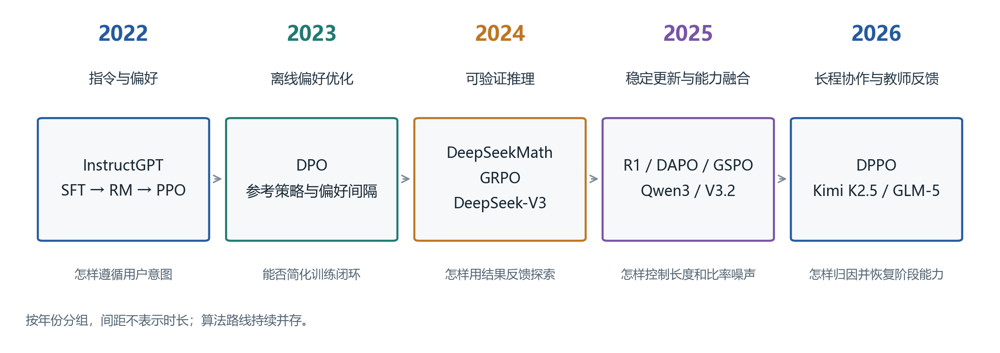
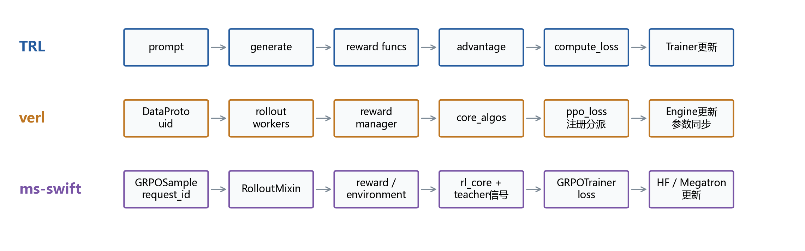
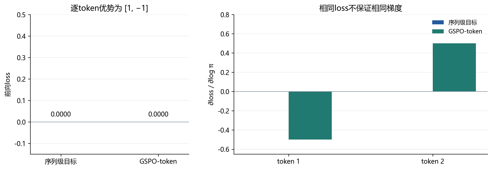

# 大语言模型后训练演进与强化学习代码研究

[GitHub 项目与复现材料](https://github.com/Can1017/LLM-HW/tree/main/hw4/p226-posttraining)

**从 DPO 和 GRPO 到 GSPO DPPO 与教师反馈**

## 摘要

本研究以少量早期方法为参照，重点分析GSPO、2026年DPPO和教师反馈的开源实现。代码研究锁定TRL、verl、ms-swift三个提交，追踪输入、rollout、奖励、优势、损失、反向传播及权重同步，并结合七份指定技术报告理解训练流程。CPU实践运行原仓库函数体及三动作策略更新，完成17项机制检查。结果显示，分组、损失分母和停止梯度位置都能改变更新；相同loss数值不足以证明实现等价。本文不包含预训练语言模型的真实训练效果。

**关键词** 后训练　GRPO　GSPO　DPPO　代码分析　在线蒸馏

## 1 研究问题和技术演进

课程题目的核心是解释“反馈如何进入训练”，并把方法落实到程序。研究采用三层证据：技术报告说明设计动机；固定版本的源码证明可见行为；局部数值和梯度检查验证具体解释。论文宣称的能力提升与本次代码观察分别记录。

图1按年份组织代表性路线。各路线持续并存，后续方法不会自动替代之前的方法。

InstructGPT 以人工示范、偏好排序和 PPO 改善指令遵循[1]；DPO 把参考策略约束写入离线偏好损失[2]。DeepSeekMath 提出的 GRPO 用同题多回答的相对奖励代替价值模型基线[3]。推理模型随后把规则验算、拒绝采样和蒸馏组合成训练阶段。近期重点又转向序列级更新、信赖域、多轮轨迹及教师在学生实际访问状态上的反馈[5–7,10]。因此，技术演进同时涉及目标、监督和系统安排，不能只排列算法名称。

## 2 方法比较和监督来源

| 方法 | 核心数据与反馈 | 优化过程 | 资源与主要限制 |
| --- | --- | --- | --- |
| SFT | 输入与合格回答 | 最大化示范的条件似然 | 无在线采样；受示范覆盖限制 |
| PPO型RLHF | prompt、人类偏好训练的奖励模型 | 在线生成；价值估计；裁剪策略梯度 | 通常含策略、参考、奖励、价值模型 |
| DPO | 同一prompt的优选与劣选回答 | 优化相对参考策略的偏好间隔 | 无在线rollout和显式价值模型；依赖偏好质量 |
| GRPO | 同题多个候选及标量奖励 | 组内中心化和可选标准差缩放；裁剪更新 | 无critic；组内奖励相同时任务优势为零 |
| DAPO | 可验证奖励和动态筛选的题组 | Clip-Higher、动态采样、token聚合、过长处理 | 一套配方；筛选成本及分布变化需记录 |
| GSPO | 组内奖励、旧策略概率 | 长度归一化的序列比率及序列裁剪 | 裁剪尺度不同于GRPO；需核对聚合方式 |
| DPPO | 奖励、动作概率及散度近似 | 用Binary-TV/KL等构造方向性更新mask | 2026年方法；阈值与近似不能视为性能保证 |

表1比较的是训练阶段的典型实现。PPO本身不限定人类奖励；RLVR表示奖励来源，能够与多种策略优化算法结合。参考策略用于约束偏离，旧策略用于采样或近端比率，两者用途不同。

设 l+、l− 是两条回答的对数概率，DPO 的标准损失为：

$$
L_{DPO}=-\log\sigma\{\beta[(l^+_\theta-l^+_{ref})-(l^-_\theta-l^-_{ref})]\}.
$$
GRPO 的序列优势与 GSPO 的序列比率分别是：

$$
A_i=(r_i-\bar r)/(s_r+\epsilon),\qquad s_i=\exp\{T_i^{-1}\sum_t(l_{\theta,it}-l_{old,it})\}.
$$
人工示范给出期望行为；偏好指出相对选择；规则和环境给出可检验结果；教师轨迹及概率提供额外路径信息。结果奖励容易计算，却不能独自证明过程正确；过程奖励更细，但会引入裁判偏差。轨迹奖励还面临跨步骤归因。训练奖励之外应保留独立验收。

Dr.GRPO涉及取消组内标准差缩放和固定长度分母，不能仅凭一个开关宣称完整复现。DAPO同样需要检查整条采样与更新流程，设置一个名为 `dapo` 的loss只覆盖其中一部分[4]。

## 3 分析路径与完整代码执行链

三套源码于2026年11月11日锁定：TRL `d115286bc5ae`、verl `81464bb6d35c`、ms-swift `a8dccaafe932`。完整SHA、文件行号及永久链接保存在[详细分析附件](https://github.com/Can1017/LLM-HW/blob/main/hw4/p226-posttraining/reports/%E5%A4%A7%E8%AF%AD%E8%A8%80%E6%A8%A1%E5%9E%8B%E5%90%8E%E8%AE%AD%E7%BB%83%E6%BC%94%E8%BF%9B%E4%B8%8E%E5%BC%BA%E5%8C%96%E5%AD%A6%E4%B9%A0%E4%BB%A3%E7%A0%81%E7%A0%94%E7%A9%B6-%E9%99%84%E4%BB%B6.md)和[代码索引](https://github.com/Can1017/LLM-HW/blob/main/hw4/p226-posttraining/reports/%E4%BB%A3%E7%A0%81%E7%B4%A2%E5%BC%95.md)中。verl源于字节跳动，现已迁至verl-project；ms-swift为ModelScope项目。两者作为近期中国开源工程主线，TRL提供较清楚的DPO基准。

图2比较GRPO路线。DPO读取离线偏好对，不经过图中的在线生成阶段。

**TRL。**从 `DPOTrainer._compute_loss` 反查 `completion_mask`、拼接后的chosen/rejected及参考概率，确认只对回答部分累计条件对数概率。`_precompute_ref_logps` 可提前缓存固定参考模型输出。策略前向保留梯度，参考前向禁用梯度，标准sigmoid分支形成偏好损失，优化器循环由父类Trainer承担。GRPO则在 `_prepare_inputs` 中管理生成批次，在 `_generate_and_score_completions` 中得到奖励与优势，在 `_compute_loss` 中应用裁剪、KL及聚合。

**verl。**完整追踪 `RayPPOTrainer.fit`：创建带uid的 `DataProto` → 按采样数复制prompt → `generate_sequences` → 奖励和response mask → old/ref log-prob → `compute_advantage` → `_update_actor`。调用继续进入 `ActorRolloutRefWorker.update_actor`、`TrainingWorker.train_mini_batch` 和 `BaseEngine.train_batch`；FSDP引擎执行 `loss.backward()` 与 `optimizer.step()`。损失在 `workers/utils/losses.py::ppo_loss` 中按注册名选择；更新后checkpoint manager将参数同步给rollout。该链路没有停在“调用update_actor”这一层。

**ms-swift。**追踪 `RolloutTrainerMixin._generate_and_score_completions` 的模板流程：生成样本 → 奖励 → 编码及概率准备 → `_postprocess_batch`写入优势 → `GRPOTrainer._compute_loss_and_metrics`。固定组调用 `rl_core.compute_advantages`；多轮路径依据prompt/request身份去重分组。教师信息在序列优势扩展为逐token优势时加入，最终仍交给HF或Megatron后端更新。

该分析路径把公式中的奖励、优势、比率和mask逐项映射到生产者与消费者，避免从函数名推测算法。

## 4 近期训练流程与两个深入问题

**工业路线的共同点与差异。**DeepSeek-V3使用领域专家和拒绝采样整理示范，RL组合规则与模型奖励。R1先探索可验证推理，再用冷启动、筛选和蒸馏改善可用性[3,5]。Qwen3的旗舰模型采用长CoT冷启动、推理RL、模式融合、通用RL，小模型另用离线及on-policy蒸馏[6]。V3.2采用专家蒸馏与混合RL，把推理、agent和人类对齐纳入同一阶段[7]。

Kimi K2.5按能力组织文本和视觉RL；PARL训练调度者并冻结子agent，奖励同时考虑任务结果、实例化探索和子任务完成，并逐渐减弱辅助奖励[8]。GLM-5在推理、agent与通用RL后，用各阶段检查点作教师，缓解顺序优化的能力回退；agent阶段采用异步解耦和原始token保留[9]。这些是报告披露的设计；本次检查的通用框架不是这些模型完整训练配方的复现。

**问题一 为什么还需要GSPO-token。**GSPO原目标以同一序列优势加权整条回答；GSPO-token通过 `detach` 保留相同的序列比率数值，却允许逐token优势。verl的 `compute_policy_loss_gspo` 对应论文GSPO-token形式[10]；ms-swift明确区分 `sequence` 与 `sequence_token`。当教师给出逐token信号时，不能仅比较前向loss或把两种配置混为一谈。

**问题二 DPPO究竟改变了什么。**PPO的概率比率只反映相对变化：从0.001到0.0015、从0.5到0.75，比率都为1.5，概率移动却不同。DPPO把信赖域判断改为散度近似，并按优势方向保留更新；verl实现了Binary-TV和Binary-KL，Top-K版本需参考作者仓库[11]。这与GSPO改变比率粒度属于不同设计维度，是否组合有效仍需实验。

图3左侧保持概率比率为1.5，观察不同旧概率对应的绝对变化；右侧来自本次合成张量实践。PPO比例阈值为0.2，DPPO的TV和KL阈值分别为0.1和0.01。阈值单位不同，这张图解释更新mask的机制，不构成模型效果或算法性能排名。

**教师反馈的可见落点。**ms-swift允许把教师与学生在同一采样token上的log-prob差加入优势，也支持RLSD正权重重分配。前者可能改变逐token方向，后者保留环境优势的符号。它们提示了一个可研究的折中：让规则决定整条轨迹是否成功，让教师帮助定位轨迹内部应调整的部分。教师更可靠这一前提仍需独立检查。

## 5 可运行的代码机制实践

使用本机Python 3.11和PyTorch 2.5.1 CPU运行[mechanism_lab.py](https://github.com/Can1017/LLM-HW/blob/main/hw4/p226-posttraining/research/scripts/mechanism_lab.py)。脚本从锁定仓库提取原函数体，记录文件SHA256和行号，调用真实的mask及 `agg_loss` 辅助函数；仅以数据容器适配配置，未启动完整Trainer。另执行TRL原sigmoid分支及三动作策略的SGD更新。17项检查通过，原始数据保存在[mechanism_lab.json](https://github.com/Can1017/LLM-HW/blob/main/hw4/p226-posttraining/research/results/mechanism_lab.json)。

| 研究操作 | 观察 | 支持的结论 |
| --- | --- | --- |
| 同奖励分组，比较两仓库 | GRPO优势约±0.7071；epsilon造成微差 | 归一化机制相符，不代表完整训练等价 |
| 将同题候选交错重排 | uid分组保持含义；连续分组出现符号变化 | 分组约定属于算法前提 |
| 长度2和6的回答，更换loss聚合 | token平均得到2.5；序列平均得到2.0 | 损失分母决定样本与token权重 |
| GSPO与GSPO-token，优势为[1,−1] | 前向loss均0；梯度分别[0,0]和[−0.5,0.5] | 前向一致不证明反向一致 |
| 构造DPO偏好反例 | loss从0.6931降至0.5975，chosen概率从0.20降至0.15 | 相对偏好提升不保证绝对概率提升 |
| 教师重加权和request去重 | 优势为[1.1,0.9]／[−0.9,−1.1]；重复请求同优势 | 符号约束与样本身份能够局部检验 |

图4左侧比较合成样例的loss，右侧给出对采样token对数概率的梯度。结论针对逐token优势；同一序列内优势恒定时，两种GSPO形式的梯度检查一致，与原论文相符。

图5将同一损失矩阵按三种方式聚合。token平均下，长度为6的回答获得更大的总权重；序列平均使两条回答各占一半；固定分母则改变整体尺度。因而，比较算法时只对齐学习率和batch大小还不够，损失分母也是实际目标的一部分。

这些检查提供可复查的程序证据，不能证明语言理解或推理能力提高。DPPO的局部检查采用不同单位的示意阈值，未用于算法性能排名。完整仓库导入曾受缺少Ray等依赖影响，因此明确限定为源码纯函数和极小策略实践。

## 6 研究收获与可检验的下一步

本次代码阅读把研究重点从“哪个算法更新”转到“新增信息和梯度来自哪里”。奖励函数相同，分组、掩码或聚合不同，也会得到不同更新；教师信息更多，也可能带来新的偏差。模型报告中的多阶段训练、专家蒸馏和异步系统，分别处理信息不足、能力干扰和资源利用问题，不能用一个平均分混合解释。

三个值得继续检验的想法是：第一，在学生已经有部分成功率的任务上，比较等成本追加示范与教师逐token反馈；第二，按奖励零方差、负优势和回答长度分层记录样本，判断动态采样的收益来自学习信号还是题目分布变化；第三，在固定rollout预算下同时观察pass@1、pass@k、条件变式和过程错误，区分选择集中与可迁移改进。这些均是待检验假设，不是本次已得到的模型结论。

本机4GB显存下，可从短条件问答或抽取任务的0.5B LoRA SFT/DPO开始；若开展在线RL，应先测试候选间是否存在奖励差异。训练前冻结独立测试、数据生成规则和计算账本，记录生成token、峰值显存及人为数据整理时间。若复杂方法不优于等成本数据补充，负结果仍能指导后续投入。

**研究边界。**已完成指定报告后训练章节阅读、三套源码分析及CPU机制实践。未开展预训练语言模型训练、集群端到端复现或能力提升评测。代码与文献采用固定版本，完整执行路径、数学细节、引用核验、图源码及探索记录在附件；真实实验可以直接续接，而无需把本次局部结果包装为训练成绩。

## 7 代码与补充材料

本报告对应的代码、数据和补充文档集中保存在[GitHub 项目目录](https://github.com/Can1017/LLM-HW/tree/main/hw4/p226-posttraining)。图片直接从GitHub在线加载，单独保存本Markdown文件也可以显示图表。

| 材料 | 内容 |
| --- | --- |
| [代码分析与研究记录](https://github.com/Can1017/LLM-HW/blob/main/hw4/p226-posttraining/reports/%E5%A4%A7%E8%AF%AD%E8%A8%80%E6%A8%A1%E5%9E%8B%E5%90%8E%E8%AE%AD%E7%BB%83%E6%BC%94%E8%BF%9B%E4%B8%8E%E5%BC%BA%E5%8C%96%E5%AD%A6%E4%B9%A0%E4%BB%A3%E7%A0%81%E7%A0%94%E7%A9%B6-%E9%99%84%E4%BB%B6.md) | 三套源码深读、指定报告阅读位置、实践过程与边界 |
| [31个固定版本代码链接](https://github.com/Can1017/LLM-HW/blob/main/hw4/p226-posttraining/reports/%E4%BB%A3%E7%A0%81%E7%B4%A2%E5%BC%95.md) | 从真实AST节点生成的文件位置与永久行号 |
| [CPU机制实践脚本](https://github.com/Can1017/LLM-HW/blob/main/hw4/p226-posttraining/research/scripts/mechanism_lab.py) | 原函数体、配置适配、梯度检查和三动作策略更新 |
| [原始实践结果](https://github.com/Can1017/LLM-HW/blob/main/hw4/p226-posttraining/research/results/mechanism_lab.json) | 17项检查、数值、梯度、环境和源码哈希 |
| [13篇文献核验记录](https://github.com/Can1017/LLM-HW/blob/main/hw4/p226-posttraining/research/references-verified.json) | 版本、PDF哈希及阅读位置 |
| [图表生成脚本](https://github.com/Can1017/LLM-HW/blob/main/hw4/p226-posttraining/research/scripts/generate_figures.py)与[矢量图源](https://github.com/Can1017/LLM-HW/tree/main/hw4/p226-posttraining/reports/figures) | 本文五组图表的生成过程与SVG源码 |
| [10分钟汇报讲稿](https://github.com/Can1017/LLM-HW/blob/main/hw4/p226-posttraining/reports/10%E5%88%86%E9%92%9F%E6%B1%87%E6%8A%A5%E8%AE%B2%E7%A8%BF.md) | 讲述顺序、演示提示和可能追问 |

复现机制实践需要Python、PyTorch CPU和NumPy，以及[来源清单](https://github.com/Can1017/LLM-HW/blob/main/hw4/p226-posttraining/research/sources.json)中固定提交的三套仓库；不需要GPU、预训练模型权重或启动Ray集群。具体准备方式见[项目README](https://github.com/Can1017/LLM-HW/blob/main/hw4/p226-posttraining/README.md)。

## 参考文献

[1] Ouyang等. Training language models to follow instructions with human feedback. 2022. [2203.02155v1](https://arxiv.org/abs/2203.02155v1).

[2] Rafailov等. Direct Preference Optimization. 2023. [2305.18290v3](https://arxiv.org/abs/2305.18290v3).

[3] Shao等. DeepSeekMath. 2024. [2402.03300v3](https://arxiv.org/abs/2402.03300v3). DeepSeek-AI. DeepSeek-V3 Technical Report. [2412.19437v2](https://arxiv.org/abs/2412.19437v2).

[4] Yu等. DAPO. 2025. [2503.14476v2](https://arxiv.org/abs/2503.14476v2). Liu等. Understanding R1-Zero-Like Training. [2503.20783v2](https://arxiv.org/abs/2503.20783v2).

[5] DeepSeek-AI. DeepSeek-R1. 2025，本文阅读2026年修订版. [2501.12948v2](https://arxiv.org/abs/2501.12948v2).

[6] Yang等. Qwen3 Technical Report. 2025. [2505.09388v1](https://arxiv.org/abs/2505.09388v1).

[7] DeepSeek-AI. DeepSeek-V3.2. 2025. [2512.02556v1](https://arxiv.org/abs/2512.02556v1).

[8] Kimi Team. Kimi K2.5 Visual Agentic Intelligence. 2026. [2602.02276v2](https://arxiv.org/abs/2602.02276v2).

[9] Zeng等. GLM-5. 2026. [2602.15763v2](https://arxiv.org/abs/2602.15763v2).

[10] Zheng等. Group Sequence Policy Optimization. 2025. [2507.18071v2](https://arxiv.org/abs/2507.18071v2).

[11] Qi等. Rethinking the Trust Region in LLM Reinforcement Learning. 2026. [2602.04879v3](https://arxiv.org/abs/2602.04879v3).
