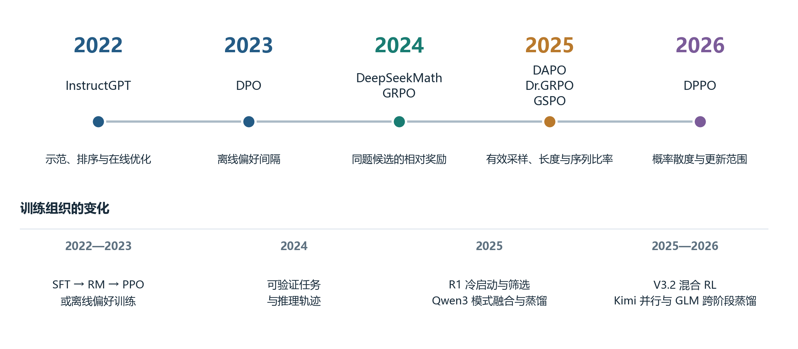
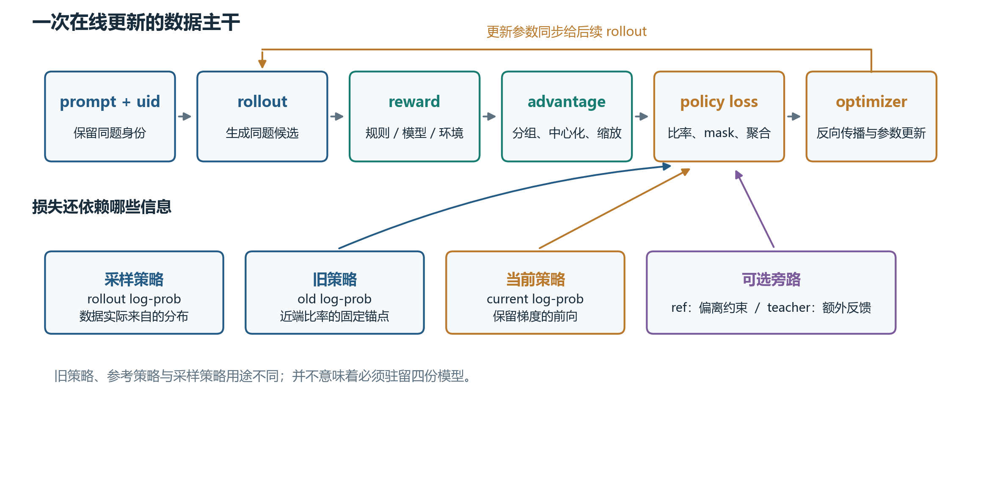
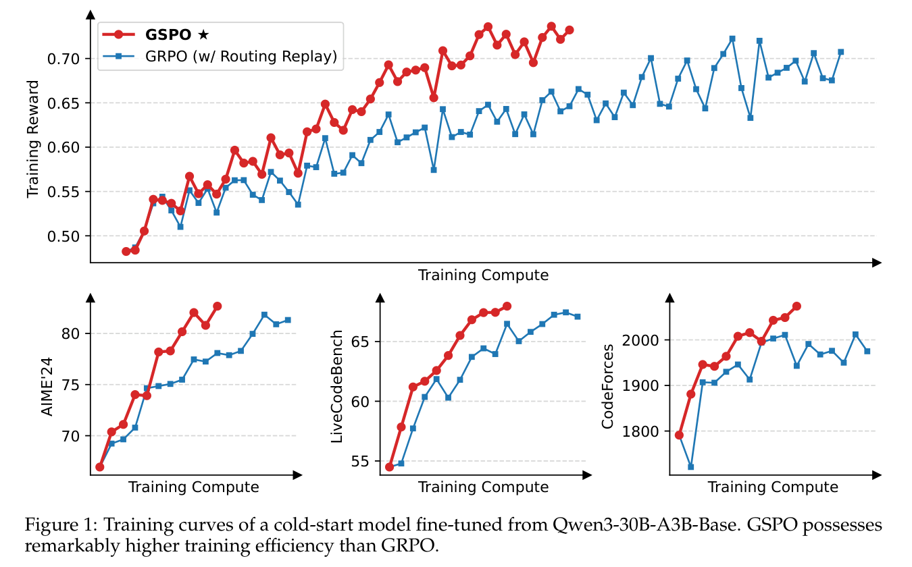
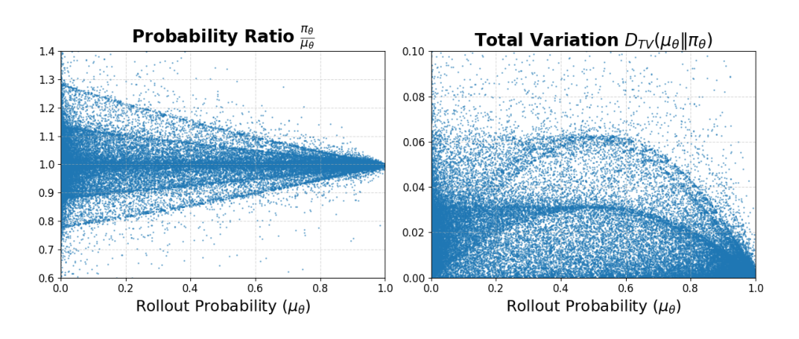
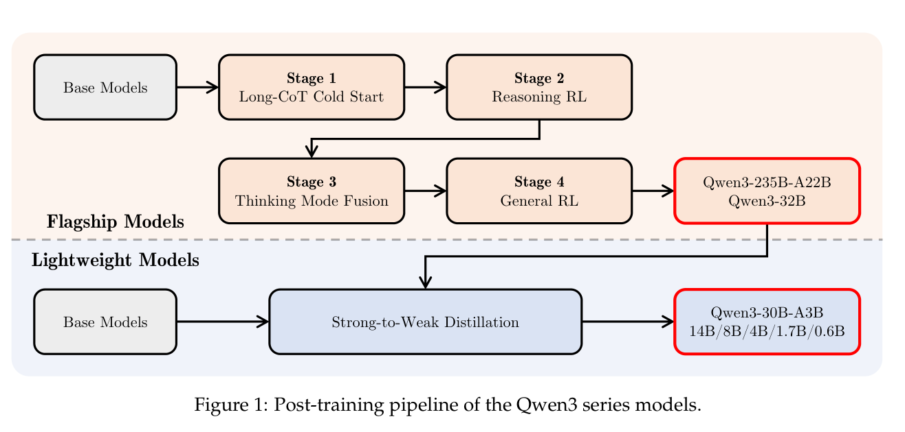
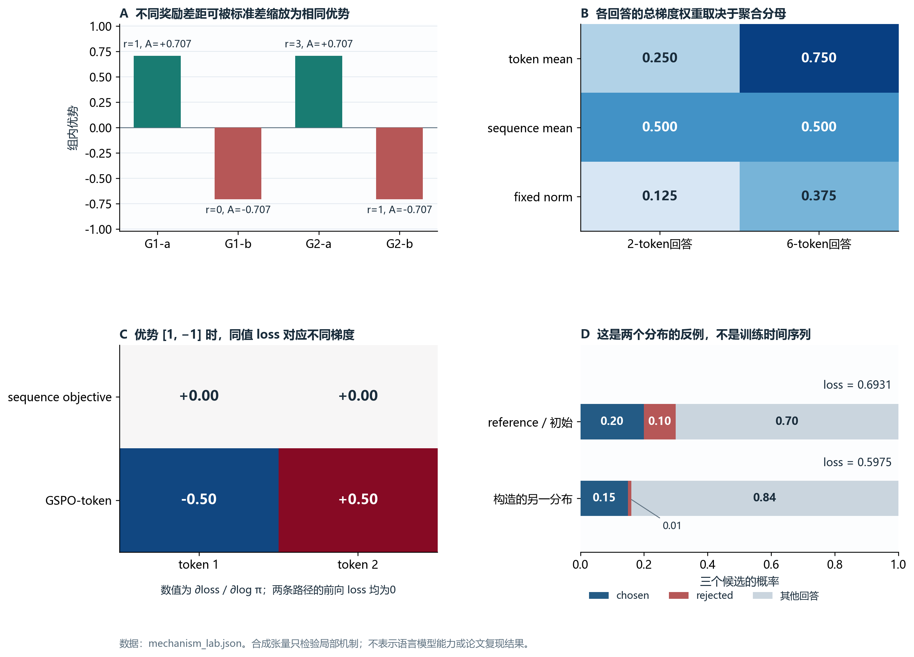

# 大语言模型后训练演进与强化学习代码研究

**从 DPO、GRPO 到 GSPO、DPPO：沿着反馈、概率和梯度读懂开源实现**

[GitHub 项目与复现材料](https://github.com/Can1017/LLM-HW/tree/main/hw4/p226-posttraining)

## 摘要

本研究围绕“大语言模型后训练怎样把反馈转化为参数更新”展开。以 InstructGPT 和 DPO 为早期参照，重点阅读 GRPO、DAPO、GSPO、2026 年的 DPPO，以及近期模型报告中的在线蒸馏与 agent 强化学习。代码分析选择 TRL、verl、ms-swift 三个固定提交：从数据和候选生成开始，追踪奖励、优势、策略概率、损失聚合、反向传播及权重同步。随后在本机 CPU 上运行原仓库中的纯张量函数，并对一个三动作策略执行实际梯度更新，完成17项机制检查。

研究中最有价值的发现不是某个算法“更先进”，而是几个容易被方法名称掩盖的条件：同题候选的分组身份决定谁与谁比较；损失的分母决定长短回答的相对权重；旧策略、参考策略和采样策略承担不同角色；前向损失相同并不保证逐 token 梯度相同。报告据此解释 DPO 的相对偏好目标、GRPO 的有效训练信号、GSPO-token 的停止梯度写法，以及 DPPO 的散度信赖域。论文中的模型效果、源码中的实现事实和本次局部实践分别呈现，不把局部张量结果当作语言模型能力评测。

**关键词：**大语言模型；后训练；强化学习；GRPO；GSPO；DPPO；代码分析；在线蒸馏

## 1 研究从哪里开始：先把“读懂代码”变成具体问题

### 1.1 为什么没有从训练命令开始

课程要求“有基础的同学”深入至少2—3个后训练代码，提交自己的分析路径、成果和收获。如果仅运行一个现成训练命令，即使日志中的 reward 上升，也未必能够解释模型为什么发生变化。反过来，只抄写算法公式，又容易忽略真实系统怎样处理样本分组、推理概率和梯度累积。

因此，我将这次研究的主问题定为：

> 一个 prompt 进入后训练系统以后，哪些信息最终影响了梯度？这些信息由谁产生，怎样被转换，又在哪一步真正改变参数？

本机显存只有4GB，已有 PyTorch 环境为 CPU 版本。本次按任务范围完成论文与代码研究，并寻找可以真实运行的机制实践，暂不开展语言模型训练。选择这个范围以后，实践仍需要产生可复查结果：原函数体有没有执行，梯度有没有计算，代码解释是否经得起反例检验。这比把“命令启动成功”作为研究成果更接近题目的目的。

### 1.2 三个仓库怎样形成互补

| 项目 | 为什么选择 | 本次重点 |
| --- | --- | --- |
| [TRL](https://github.com/huggingface/trl/tree/d115286bc5aef8d346e8510bfe312803c7881c4a) | Trainer 层的算法实现比较集中，适合从公式进入程序 | DPO 的数据掩码、参考概率、偏好损失；GRPO 的生成批次和 loss |
| [verl](https://github.com/volcengine/verl/tree/81464bb6d35cbb43962be42b0088a591e7020f21) | 源于字节跳动，能看到 driver、rollout 和训练引擎的责任边界 | GRPO 分组、GSPO-token、DPPO、损失分派、实际优化步骤 |
| [ms-swift](https://github.com/modelscope/ms-swift/tree/a8dccaafe9324a5d454c44703e3dce92370f5c1c) | ModelScope 的工程实现将多轮样本、教师反馈和不同后端连接起来 | request 去重、逐 token 优势、RLSD 重加权、生成与训练接口 |

三套代码于2026年11月11日锁定。完整提交分别为 `d115286bc5aef8d346e8510bfe312803c7881c4a`、`81464bb6d35cbb43962be42b0088a591e7020f21`、`a8dccaafe9324a5d454c44703e3dce92370f5c1c`。后文的行号均对应这些提交，不能直接套用到后来更新的主分支。

分析时，我先找输入与训练循环，再找 reward、advantage 和 loss，最后追到 optimizer。每读到一个看似普通的字段，就问它是否会改变目标。例如 `uid` 是日志标识还是分组依据？`completion_mask` 只是去掉 padding，还是还排除了 prompt？`old_log_probs` 是采样时保存的概率，还是训练前重算的概率？这些问题逐渐形成了本文的叙述顺序。

文中沿用源码的几个常用词：prompt是输入，rollout是策略实际生成回答或交互轨迹，batch是一次处理的一组样本，log-prob是概率的对数；advantage表示相对基线的好坏程度，mask表示哪些位置有效。后文会具体说明这些量如何计算，而不把名称本身当成解释。

## 2 方法演进：问题怎样从偏好对齐走到序列更新和系统一致性

### 2.1 技术路线不是一条替代链

InstructGPT 的核心问题是预训练模型与用户意图之间存在距离。其路线以人工示范训练 SFT 模型，再用人工排序训练奖励模型，最后通过 PPO 优化策略[1]。示范、排序和在线采样提供不同信息，不能仅用“用了强化学习”概括。

DPO 将常见的偏好优化目标改写为离线偏好对上的损失，减少显式奖励模型和在线优化循环[2]。但这并不意味着 reference policy 消失了，也不意味着偏好数据天然可靠。它把一部分系统复杂度转移到了数据与相对概率计算。

DeepSeekMath 的 GRPO 用同题多候选的奖励构造相对优势，从而免去单独的价值模型[3]。随后，R1等推理模型把规则验算、冷启动、拒绝采样和蒸馏结合起来[4–5]。这时，问题已经从“输出是否更符合偏好”扩展为“模型能否探索到正确轨迹，反馈能否稳定地帮助它更新”。

DAPO、Dr.GRPO、GSPO和DPPO分别继续追问：没有奖励差异的题组怎么办？长回答是否被错误加权？token 概率比率是否噪声过大？裁剪区间是否真的对应合适的信赖域[6–9]？这些方法修改的层次不同，不应写成“后一个算法全面淘汰前一个算法”。

**图1 后训练演进图。**按年份归纳代表性变化，图中箭头表达研究问题的延续，不表示方法之间存在唯一因果关系。2026年同时包含优化目标和训练组织方式的创新。

### 2.2 比较前先分清方法所处的层次

| 方法或设置 | 主要输入 | 更新方式 | 模型与成本特征 | 需要特别检查 |
| --- | --- | --- | --- | --- |
| SFT | prompt 与合格示范 | 最大化示范的条件似然 | 无训练时在线采样 | 数据覆盖、答案 mask、模板泛化 |
| PPO 型 RLHF | prompt、奖励模型反馈 | 在线采样、价值估计、裁剪策略梯度 | 典型系统包含策略、参考、奖励和价值模型 | 奖励过优化、KL、采样和更新同步 |
| DPO | 同 prompt 的 chosen/rejected | 相对参考策略的偏好损失 | 无需训练时在线 rollout 和显式 critic | reference 是否固定、偏好噪声、长度 |
| GRPO | 同题多个候选和奖励 | 组内优势、PPO 类策略更新 | 无单独 critic；采样成本仍在 | 分组、零方差、归一化与 loss 分母 |
| DAPO | 可验证任务和动态采样题组 | 解耦裁剪、动态采样、token 聚合、过长处理 | 一套数据与更新配方 | 是否只切换 loss，是否统计筛选成本 |
| GSPO / GSPO-token | 奖励、旧策略和当前策略概率 | 长度归一化序列比率，序列级裁剪 | 适用于长回答等场景；仍依赖 rollout | 序列内优势是否恒定、聚合与裁剪尺度 |
| DPPO | 奖励、策略概率与散度近似 | 散度条件下的方向性更新 mask | 2026年方法；集成实现存在近似边界 | Binary/Top-K区别、阈值单位、截断权重 |
| RLVR | 可由规则或环境检验的任务 | 可以搭配上述多种优化器 | 是反馈来源的设置，不是独立优化算法 | 验证器覆盖、答案正确与过程正确的差异 |

表1中的 PPO 型 RLHF 指常见的大模型偏好训练系统；PPO 算法本身并不限定必须使用人类反馈。GRPO 也不是只能使用规则奖励，代码可以接收奖励模型或环境反馈。比较时把“反馈来自哪里”和“怎样更新策略”分开，会比只比较算法名称清楚。

## 3 第一站 TRL：DPO 到底让什么概率变大

### 3.1 从参考概率反查数据与 mask

我首先定位 [DPOTrainer._compute_loss](https://github.com/huggingface/trl/blob/d115286bc5aef8d346e8510bfe312803c7881c4a/trl/trainer/dpo_trainer.py#L1354)，再反查它的输入。chosen 和 rejected 共享 prompt，经数据整理后沿 batch 维拼接。`completion_mask` 标记回答区域，prompt及其他不参与监督的位置通过标签掩码排除；策略模型对回答 token 的 log-prob 累加，得到回答的条件序列概率。

这里求的是序列 log-prob 的和。如果擅自改成 token 均值，长短回答的偏好间隔就发生变化。因此，mask 与序列聚合并不只是训练速度问题，它们属于目标定义的一部分。

标准 DPO 使用以下目标，其中 $y^+$ 和 $y^-$ 分别表示优选与劣选回答：

$$
L_{\mathrm{DPO}}
=-\log\sigma\left(
\beta\left[
\log\frac{\pi_\theta(y^+\mid x)}{\pi_{\mathrm{ref}}(y^+\mid x)}
-\log\frac{\pi_\theta(y^-\mid x)}{\pi_{\mathrm{ref}}(y^-\mid x)}
\right]\right).
$$

固定源码中有多种散度和 loss 分支。只抽出普通 reverse-KL 与 sigmoid 配置，逻辑如下。下面是为说明变量关系做的等价摘写，完整分支见原文件。

~~~python
chosen_logratios = chosen_logps - ref_chosen_logps
rejected_logratios = rejected_logps - ref_rejected_logps

# ordinary DPO: reverse_kl + sigmoid
delta_score = chosen_logratios - rejected_logratios
per_sequence_loss = -F.logsigmoid(self.beta * delta_score)
~~~

策略前向保留梯度，reference 前向禁用梯度。[_precompute_ref_logps](https://github.com/huggingface/trl/blob/d115286bc5aef8d346e8510bfe312803c7881c4a/trl/trainer/dpo_trainer.py#L1237) 还允许提前计算并缓存参考概率，减少训练时的额外开销。PEFT 路径可以通过参考 adapter 或禁用当前 adapter 恢复参考状态。因此，“没有单独驻留一个 reference model”和“目标中没有 reference policy”是两回事。

### 3.2 为什么 loss 下降不能直接解释为 chosen 概率上升

读到相对 log-ratio 后，我产生了一个问题：DPO 的目标只约束两个回答之间的间隔，那么 chosen 的绝对概率是否必须上升？

我构造了一个只有三个候选的概率空间。第三个候选表示偏好对没有覆盖的其他回答。

| 概率分布 | chosen | rejected | 其他回答 |
| --- | ---: | ---: | ---: |
| reference，同时作为初始策略 | 0.20 | 0.10 | 0.70 |
| 人为构造的另一策略 | 0.15 | 0.01 | 0.84 |

在第二个分布中，chosen 概率下降，rejected 下降得更多。相对间隔为：

$$
\log(0.15/0.20)-\log(0.01/0.10)=\log(7.5)>0.
$$

取 $\beta=0.1$，源码 sigmoid 分支给出的 loss 从 $0.693147$ 降到 $0.597468$。这个反例证明的是目标不保证 chosen 绝对概率单调增加；它没有证明实际训练一定沿这条轨迹运动。

为区分二者，我又让三动作 softmax 策略实际执行 SGD。在本次设置下，step 0到step 3的 loss 从 $0.693147$ 降到 $0.691649$，chosen 概率从 $0.200000$ 升到 $0.202710$。构造反例与真实优化结果均保存在原始 JSON 中。前者检验目标允许什么，后者说明一个具体优化设置做了什么。

由此得到的阅读收获是：`reward margin` 和偏好准确率可以帮助监控 DPO，但不能直接代表事实性、正确率或所有候选上的概率改善。需要独立任务评价，才能知道相对偏好更新是否符合真正目标。

## 4 第二站 verl：把一次更新从 prompt 追到 optimizer

### 4.1 先区分四种策略角色

转向在线 RL 后，模型需要生成回答，生成时与更新时的状态未必相同。我在阅读 [RayPPOTrainer.fit](https://github.com/volcengine/verl/blob/81464bb6d35cbb43962be42b0088a591e7020f21/verl/trainer/ppo/ray_trainer.py#L1407) 时，先整理出下面四个角色。

| 角色 | 对应信息 | 用途 |
| --- | --- | --- |
| 当前策略 $\pi_\theta$ | 当前 forward 的 `log_prob` | 参与反向传播，是实际更新对象 |
| 旧策略 $\pi_{\mathrm{old}}$ | `old_log_probs` | 在一个更新批次中充当近端锚点，构成新旧策略比率 |
| 采样策略 $\pi_{\mathrm{rollout}}$ | 推理引擎返回的 `rollout_log_probs` | 描述数据实际来自哪个生成分布 |
| 参考策略 $\pi_{\mathrm{ref}}$ | `ref_log_prob` | 可选的参考正则，用来约束策略偏离 |

这些角色不一定对应四份同时驻留的模型。某些概率可以缓存，某些策略共享权重；重要的是它们在目标中承担什么作用。即使训练和推理引擎拿到相同参数，也可能因计算路径、精度或采样设置产生概率差异。因此，“old”和“rollout”不能仅凭名字相近就互换，“old”和“ref”更不能混用。

### 4.2 driver 怎样组织一个批次

`fit` 为输入建立 `DataProto`，给每个原 prompt 分配 uid，然后按 `rollout.n` 复制 prompt。生成器返回 completion、采样信息等字段后，再与原输入合并。后续大体顺序是：

~~~text
数据与 uid
  → 同题多候选生成
  → reward、response mask
  → old/ref log-prob，必要时计算 critic value
  → advantage
  → actor/critic 更新
  → 参数同步回 rollout，并评测或保存检查点
~~~

循环中还能看到批次平衡、奖励处理和 rollout correction。这些步骤可能改变排列或有效 token 数，因此不宜只找最后一个 loss 函数就结束分析。

**图2 在线后训练的执行链。**主干表示数据经过生成、评价和更新；旁路分别标出概率来源与可选教师信号。本文三套框架都能在这个结构中找到对应模块，具体支持范围以所读提交为准。

### 4.3 GRPO 的组内优势在哪里形成

[compute_grpo_outcome_advantage](https://github.com/volcengine/verl/blob/81464bb6d35cbb43962be42b0088a591e7020f21/verl/trainer/ppo/core_algos.py#L268) 先将 token reward 沿回答维求和，得到每条回答的分数；再按 `index` 将同题候选归组。其核心原文摘录如下，省略了异常分支和容器初始化。

~~~python
scores = token_level_rewards.sum(dim=-1)

scores_tensor = torch.stack(id2score[idx])
id2mean[idx] = torch.mean(scores_tensor)
id2std[idx] = torch.std(scores_tensor)

if norm_adv_by_std_in_grpo:
    scores[i] = (scores[i] - id2mean[index[i]]) / (
        id2std[index[i]] + epsilon
    )
else:
    scores[i] = scores[i] - id2mean[index[i]]
~~~

接下来，源码把每条回答的标量优势扩展到 token 维，并乘 `response_mask`。这段代码回答了两个问题：相对优势来自同一 prompt 的奖励统计，token mask 则决定回答中哪些位置参与更新。

我用两个二样本组 $[1,0]$ 和 $[3,1]$ 检查它。中心化以后分别是 $[0.5,-0.5]$ 和 $[1,-1]$；除以各自的样本标准差后，两组都接近 $[0.7071,-0.7071]$。奖励差距不同，却产生近似相同的标准化优势。这说明标准差归一化改变了不同题组之间的相对尺度，不能把它当作纯粹的数值稳定措施。

两份实现的小数并非完全一样：verl 默认 epsilon 为 $10^{-6}$，ms-swift 对应路径为 $10^{-4}$。本次差异在约 $10^{-4}$ 范围内，回查源码可以解释，而不应将它夸大成训练原理不同。

另一个检查更能说明分组的作用。我把四个回答按 $[0,2,1,3]$ 交错重排。按 uid 分组的实现仍然保留原题的奖励比较；如果只按连续位置两两分组，就会把不同题放到一起，部分优势符号随之变化。这不是后者的 bug，它依赖“同题候选连续排列”的输入约定。修改 dataloader 或动态采样时，必须维护这个约定。

### 4.4 真正的更新没有停在 update_actor

调用链继续进入：

~~~text
RayPPOTrainer._update_actor
  → ActorRolloutRefWorker.update_actor
  → TrainingWorker.train_mini_batch
  → TrainingWorker.train_batch
  → BaseEngine.train_batch
~~~

[workers/utils/losses.py::ppo_loss](https://github.com/volcengine/verl/blob/81464bb6d35cbb43962be42b0088a591e7020f21/verl/workers/utils/losses.py#L57) 根据配置分派损失，而不是把所有算法写死在训练主循环中。下面摘录了这条分派路径的主要关系：

~~~python
loss_mode = config.policy_loss.get("loss_mode", "vanilla")
policy_loss_fn = get_policy_loss_fn(loss_mode)
pg_loss, pg_metrics = policy_loss_fn(
    old_log_prob=old_log_prob,
    log_prob=log_prob,
    advantages=advantages,
    response_mask=response_mask,
    loss_agg_mode=loss_agg_mode,
    config=config,
    rollout_is_weights=rollout_is_weights,
    **policy_loss_kwargs,
)
~~~

[BaseEngine.train_batch](https://github.com/volcengine/verl/blob/81464bb6d35cbb43962be42b0088a591e7020f21/verl/workers/engine/base.py#L113) 随后执行：

~~~python
self.optimizer_zero_grad()
outputs = self.forward_backward_batch(data, loss_function, forward_only=False)
grad_norm = self.optimizer_step()
~~~

继续查看 FSDP 引擎，可以定位到实际 `loss.backward()` 与 `optimizer.step()`。更新后，主循环再把参数同步给 rollout 副本。

这条路径使我意识到：`adv_estimator=grpo` 只指定优势估计。policy loss、聚合方式、参考 KL 和 rollout correction 仍是不同的配置维度。复现实验时，仅报告一个算法名是不够的。

## 5 从 GRPO 到 DAPO：有效信号和损失分母也是方法

为理解后续几种修改，可以先把常见的PPO类策略项写成统一形式。设 $r_{i,t}$ 是当前策略相对旧策略的概率比率，$A_{i,t}$ 是优势，则未聚合的最小化损失为：

$$
\ell_{i,t}=-\min\left(
r_{i,t}A_{i,t},
\operatorname{clip}(r_{i,t},1-\epsilon_{\mathrm{low}},1+\epsilon_{\mathrm{high}})A_{i,t}
\right).
$$

最终还要通过mask与聚合函数变成一个标量。这里省略可选的KL、熵和其他辅助项，以便看清三个可分别改变的位置：优势怎样估计，比率怎样定义，token损失怎样汇总。GRPO、GSPO和DAPO并不只是在同一个公式中换一个名字。

### 5.1 零方差组为什么值得单独统计

如果一组候选得到完全相同的结果奖励，减去组均值后任务优势为零。即使 GPU 花时间生成了这些回答，这个组也没有提供组内优劣方向。注意，这里说的是该任务奖励对应的优势项为零；如果训练还加入 KL、熵或教师信号，总梯度不一定为零。

DAPO 的动态采样会筛选有区分信号的题组，但这不是免费收益[6]。为了得到同样大小的有效 batch，可能生成并丢弃更多候选，也可能改变实际训练题目的难度分布。因此实验不能只匹配“更新了多少步”，还要记录生成组数、保留比例和 token 成本。

DAPO 还包括 Clip-Higher、token-level policy gradient loss 和 overlong reward shaping。四项机制分别处理探索、有效采样、长回答权重和截断带来的奖励噪声。把 `loss_type` 改成 `dapo`，不等于完整复现这套配方。

### 5.2 分母怎样改变长短回答的影响

我直接运行 verl 的 [agg_loss](https://github.com/volcengine/verl/blob/81464bb6d35cbb43962be42b0088a591e7020f21/verl/trainer/ppo/core_algos.py#L1140)，构造两条回答：第一条长度2，每个有效位置的 loss 为1；第二条长度6，每个有效位置的 loss 为3。于是两条序列的 token loss 和分别为2和18。

$$
L_{\mathrm{token\ mean}}=(2+18)/(2+6)=2.5,
$$

$$
L_{\mathrm{sequence\ mean}}=(2/2+18/6)/2=2.0.
$$

两种聚合在同一个矩阵上得到不同值，更重要的是梯度权重不同。token mean 对每个有效 token 使用相同分母，长回答因 token 更多而占更大总权重；sequence mean 先在各回答内平均，再在回答间平均，长短回答各占一半。

本次还设置固定长度分母8。这里8只是机制示例，不是上游默认值或推荐参数。

| 聚合方式 | 2-token回答的总梯度权重 | 6-token回答的总梯度权重 |
| --- | ---: | ---: |
| token mean | 0.25 | 0.75 |
| sequence mean | 0.50 | 0.50 |
| 每条序列按固定长度8归一化 | 0.125 | 0.375 |

这些权重是对构造的 loss 矩阵元素求导后，将每条回答的绝对梯度相加得到的，不是完整模型参数的梯度范数。它足以说明：比较方法时只对齐学习率和 batch 大小仍不够，loss 的分母也是优化目标的一部分。

Dr.GRPO 对原 GRPO 的分析涉及奖励标准差与回答长度的归一化偏差[7]。因此，在源码中关闭 std 缩放，只验证了其中一部分；还要检查长度分母，才能讨论与论文方法的对应关系。

## 6 深入 GSPO：为什么前向比率一样，反向更新还要看 detach

### 6.1 从 token 比率到序列比率

PPO 类目标常使用每个 token 的新旧策略概率比率：

$$
r_{i,t}(\theta)=
\exp\bigl(\ell_{\theta,i,t}-\ell_{\mathrm{old},i,t}\bigr),
$$

其中 $\ell$ 是对应 token 的条件 log-prob。GSPO 使用长度归一化的序列比率：

$$
s_i(\theta)=
\exp\left(
\frac{1}{T_i}\sum_{t=1}^{T_i}
[\ell_{\theta,i,t}-\ell_{\mathrm{old},i,t}]
\right).
$$

直观上，token 比率让同一条回答中的各位置分别决定自己的重要性权重；序列比率先概括整条回答的变化，再在回答层决定裁剪。长度归一化也使不同长度回答的比率更容易落在可比较的数值范围内。

但不能由此直接把 GRPO 的裁剪参数抄到 GSPO。原论文实验给 GSPO 与 GRPO 使用了不同量级的裁剪区间；其比较发生在特定 cold-start 模型、训练数据和采样设置下[8]。

### 6.2 verl 的 gspo 实际对应 GSPO-token 写法

在 [compute_policy_loss_gspo](https://github.com/volcengine/verl/blob/81464bb6d35cbb43962be42b0088a591e7020f21/verl/trainer/ppo/core_algos.py#L1546) 中，我看到的不是简单地 `exp(mean(log_ratio))` 后结束计算。以下为固定源码原文摘录：

~~~python
negative_approx_kl = log_prob - old_log_prob
seq_lengths = torch.sum(response_mask, dim=-1).clamp(min=1)
negative_approx_kl_seq = (
    torch.sum(negative_approx_kl * response_mask, dim=-1) / seq_lengths
)

log_seq_importance_ratio = (
    log_prob - log_prob.detach()
    + negative_approx_kl_seq.detach().unsqueeze(-1)
)
~~~

`log_prob - log_prob.detach()` 的数值为零，但对 `log_prob` 的导数为1。序列平均部分被 detach，只提供当前序列比率的数值。合起来，前向仍是序列级比率，反向却能逐 token 接收优势权重。

这对应 GSPO 论文第4.3节的 GSPO-token 形式：

$$
s_{i,t}=
\operatorname{sg}[s_i]\,
\frac{\pi_\theta(y_{i,t}\mid x,y_{i,<t})}
{\operatorname{sg}[\pi_\theta(y_{i,t}\mid x,y_{i,<t})]}.
$$

$\operatorname{sg}$ 表示停止梯度。后一个分式前向为1，因此 $s_{i,t}$ 与 $s_i$ 数值相同；反向保留当前 token 的 log-prob 梯度。论文说明，当序列内各 token 使用同一个优势时，该形式与原 GSPO 的目标和理论梯度一致；逐 token 优势变化时，它提供更细的控制。

### 6.3 用一个反向传播例子检验相等条件

我先用一条两 token 回答，把 current 与 old log-prob 设为相同，使序列比率为1，并选择未触发裁剪的点。然后比较原序列比率目标与源码中的 GSPO-token。

| 逐 token 优势 | 原序列比率路径的梯度 | GSPO-token路径的梯度 |
| --- | --- | --- |
| $[1,1]$ | $[-0.5,-0.5]$ | 约 $[-0.5,-0.5]$ |
| $[1,-1]$ | $[0,0]$ | 约 $[-0.5,+0.5]$ |

表中梯度针对采样 token 的 log-prob 坐标，不是完整模型参数。第二行中，两种路径的 loss 都为零，但原序列路径看到相抵的平均优势，梯度也相抵；GSPO-token 则对两个位置给出相反方向。源码 mask 分母中的小 epsilon 带来数值微差，因此表中采用近似表达。

这不是发现上游实现有误，而是在验证论文的等价条件。它的实际意义是：**当教师或过程评价引入逐 token 优势后，不能继续默认所有序列级与 token 变体都等价。**只比较打印出的 loss，恰好会漏掉这个变化。

**图3 GSPO与GRPO的论文对照，摘自文献[8] Figure 1，PDF第5页。**作者在 Qwen3-30B-A3B-Base 的 cold-start 模型上报告训练奖励及 AIME、LiveCodeBench、Codeforces 等曲线，GRPO基线包含 routing replay。图中是原论文结果，本次没有重新训练这些模型，也不据此推导本机小模型的收益。

读这张图时，我关注的是同一实验设置中方法与训练投入的关系。横轴没有提供可直接读出的GPU小时刻度，不能仅凭线条终点长度计算精确的节省比例。论文图能说明作者的证据，局部反向实践则解释其中某个代码机制，二者承担不同作用。

## 7 深入 DPPO：相同比率为何不一定意味着相同的策略移动

### 7.1 概率比率的相对尺度问题

DPPO于2026年提出，重新讨论大词表语言模型中信赖域的表达[9]。我用下面两个动作概率理解它的动机：

| 动作 | 旧概率 | 新概率 | 新旧比率 | 概率增量 |
| --- | ---: | ---: | ---: | ---: |
| 低概率动作 | 0.001 | 0.0015 | 1.5 | 0.0005 |
| 高概率动作 | 0.5 | 0.75 | 1.5 | 0.25 |

比率相同，绝对变化差了几个量级。PPO采用比率构造裁剪目标；DPPO希望更直接地控制策略散度，并考虑优势的方向。其 Binary 近似把“当前采样动作”和“词表中其余动作”合成二项分布，不需要为每个 token 保留完整词表概率。

**图4 摘自文献[9] Figure 2，PDF第2页。**作者比较相同模型参数在训练与推理引擎下的概率输出；左图为概率比率，右图为TV。它说明的是论文所观察到的引擎差异，不是本次构造的两个动作，也不是训练参数已经更新后的测量。

### 7.2 源码中究竟改变了哪一项

verl 的 [DPPO-Binary-TV](https://github.com/volcengine/verl/blob/81464bb6d35cbb43962be42b0088a591e7020f21/verl/trainer/ppo/core_algos.py#L1380) 使用下面的方向性 mask。以下保留原变量名：

~~~python
prob = torch.exp(log_prob)
old_prob = torch.exp(old_log_prob)
valid_positive_mask = (prob - old_prob) <= clip_divergence_high
valid_negative_mask = (prob - old_prob) >= -clip_divergence_low
valid_mask = torch.where(
    advantages > 0, valid_positive_mask, valid_negative_mask
)
valid_mask = valid_mask.detach().float()
~~~

正优势希望提高当前动作概率，因而限制向上的变化；负优势希望降低概率，因而限制向下的变化。它不是无方向地把所有越界动作都一律排除。`DPPO-Binary-KL` 则以旧/新二项分布的KL及对应方向条件形成 mask。

此外，源码先截断重要性比率，再停止该权重的梯度：

~~~python
truncated_ratio = torch.clamp(ratio, max=clip_ratio_c).detach()
pg_losses = -advantages * truncated_ratio * log_prob * valid_mask
~~~

因此，反向梯度来自 `log_prob`，截断权重控制幅度，散度 mask 决定是否保留。前向 loss 数值与 PPO 的 surrogate loss 并不处于可直接排名的尺度上，不能因为一个更小就说它更好。

### 7.3 本地机制检查与实现边界

对上面的两个动作，我将优势都设为正，分别使用 PPO比例阈值0.2、DPPO-TV阈值0.1、DPPO-KL阈值0.01。在这组示意设置下，PPO的两个正向更新都进入裁剪平坦区域；两种DPPO保留低概率动作，排除高概率动作，对两者 log-prob 的梯度约为 $[-0.75,0]$。

这里的阈值单位不同，实验用途是核对 mask 与梯度，而不是公平比较性能。DPPO论文还讨论Top-K近似；verl该提交文档明确说明集成了Binary-TV/Binary-KL，不能以这两个函数宣称覆盖全部论文实现。

对我而言，GSPO与DPPO最值得比较之处是修改维度不同：GSPO改变重要性比率的粒度，DPPO改变信赖域的判断。它们是否能够组合、在什么预算下值得组合，仍应交给后续受控实验。

## 8 第三站 ms-swift：多轮样本与教师反馈怎样进入优势

### 8.1 固定group与request去重

ms-swift的 `GRPOTrainer` 继承 `RolloutTrainerMixin` 和HF训练器。阅读时，我同时检查父类模板与覆写方法，才能看清“生成 → 评分 → 编码和概率准备 → 写入优势 → loss”的完整流程。

[compute_advantages](https://github.com/modelscope/ms-swift/blob/a8dccaafe9324a5d454c44703e3dce92370f5c1c/swift/rl_core/advantage.py#L20) 的固定组路径如下：

~~~python
rewards = (rewards_per_func * reward_weights.unsqueeze(0)).nansum(dim=1)
K = num_generations
grouped = rewards.view(-1, K)
group_mean = grouped.mean(dim=1).repeat_interleave(K)
~~~

它要求同一 prompt 的K条回答连续排列。第4节的交错重排例子就是在测试这个输入条件。

多轮场景另有 [compute_advantages_dynamic](https://github.com/modelscope/ms-swift/blob/a8dccaafe9324a5d454c44703e3dce92370f5c1c/swift/rl_core/advantage.py#L102)：先按 request_id 去重，再按 prompt_id 建立组统计，最后把优势映射回各回合。我输入 request 为 `[r1,r1,r2]`、奖励为 `[1,1,0]`，关闭std缩放后得到 `[0.5,0.5,-0.5]`。同一请求的重复回合获得相同的去重优势。

这说明 request identity 是算法需要的数据。一个长请求不能仅仅因为回合多，就多次进入同题baseline。与此同时，去重不等于解决了全部时序信用分配；它只是明确了这段代码如何组织比较单位。

### 8.2 教师与参考策略不是同一个概念

参考策略主要提供偏离约束，教师则提供任务或阶段能力的信息。ms-swift把教师在学生采样token上的log-prob与学生旧策略的log-prob相减，并在扩展到逐token优势时加入：

~~~python
# expand_advantage_to_per_token，原文节选
per_token_adv = advantages.unsqueeze(1).expand_as(completion_mask).clone()
if teacher_per_token_logps is not None and teacher_kl_coef != 0.0:
    signed = compute_teacher_logratio(
        teacher_per_token_logps, policy_per_token_logps, completion_mask
    )
    per_token_adv = per_token_adv + teacher_kl_coef * signed
~~~

代码见 [advantage.py:263](https://github.com/modelscope/ms-swift/blob/a8dccaafe9324a5d454c44703e3dce92370f5c1c/swift/rl_core/advantage.py#L263)。此时序列优势可以变成逐token信号，正好需要重新检查第6节的梯度等价条件。教师更自信也不保证教师一定正确，因此这条路径增加了信息，也增加了需要验证的前提。

### 8.3 RLSD提供另一种取舍：只调整强度，保留符号

[apply_rlsd_reweight](https://github.com/modelscope/ms-swift/blob/a8dccaafe9324a5d454c44703e3dce92370f5c1c/swift/rl_core/advantage.py#L294) 不直接把教师差值相加，而是根据教师/学生概率差生成正权重，再重分配原优势。关闭额外分支、只保留核心关系，可以等价写为：

~~~python
delta = teacher_logp.detach() - student_old_logp.detach()
w = torch.exp(torch.sign(base_advantage) * delta)
reweight = (1 - lam) + lam * torch.clamp(w, 1 - eps, 1 + eps)
token_advantage = base_advantage * reweight.detach()
~~~

这段是便于阅读的等价摘写，原函数还处理mask和negative_only。权重为正时，原优势的符号不变。对教师差值 $[1.9,-1.9]$，取 `lam=0.5`、`clip_range=0.2`，本次得到正优势的 $[1.1,0.9]$ 和负优势的 $[-0.9,-1.1]$；padding位置为零。

“负优势”表示低于当前比较基线，不能在所有任务中直接翻译成“答案错误”。这也是代码注释和研究解释需要区分的地方。普通教师差值可能改变局部方向，RLSD在此设置下只改变强度；选择哪一种，取决于是否希望教师覆盖环境信号，以及教师是否足够可靠。

## 9 回到模型技术报告：代码中的这些接口为什么越来越重要

### 9.1 阅读范围与深入对象

课程指定报告的后训练章节均纳入阅读，但分析精力没有平均分配。InstructGPT与DPO用于建立早期参照；R1、Qwen3和GLM-5用于理解阶段与教师；GSPO和DPPO用于深入公式、源码与梯度的对应关系。

| 报告与版本 | 本次重点阅读位置 | 与代码研究的连接 |
| --- | --- | --- |
| InstructGPT v1 | PDF第6—9页，方法与模型训练 | 示范、排序、RM和策略优化分别提供什么信息 |
| DeepSeek-V3 v2 | 第28—30、34页，后训练与蒸馏讨论 | 专家、拒绝采样与最终示范数据怎样衔接 |
| DeepSeek-R1 v2 | 第2—8页，R1-Zero和R1训练 | 在线探索与可用助手为何需要不同阶段 |
| Qwen3 v1 | 第9—12、20—21页 | 旗舰四阶段路线与小模型on-policy蒸馏 |
| DeepSeek-V3.2 v1 | 第5—10页，后训练与Scaling GRPO | 专家蒸馏、混合RL和训练稳定性 |
| Kimi K2.5 v2 | 第4—6页及第4.4节 | 并行调度的学习对象与奖励分解 |
| GLM-5 v2 | 第10—17页，第3—4节 | 异步agent、训练推理修正和跨阶段蒸馏 |

表2采用下载PDF的实际页序。R1的v2、DPPO的v3等是修订版本，正文年份与本次阅读版本分别注明，不能把不同版本的页码和实验结果混用。核验信息见GitHub中的文献记录。

### 9.2 R1与V3：先探索，再整理，最后重新优化

R1-Zero的实验与R1成品路线需要分开理解。前者检验在特定基础模型和规则奖励下能否激励推理行为；后者还需要解决表达可读性、语言混杂和通用能力等问题[5]。因此，冷启动数据、在线RL、拒绝采样、再次SFT与后续RL各自承担不同任务。

DeepSeek-V3报告中的领域专家和筛选也体现了类似思路[4]：探索所得的高质量轨迹可以被整理为下一阶段的示范，而不是要求所有目标一直通过同一种反馈在线学习。

这改变了我对“SFT与RL谁更好”的理解。它们并不总是竞争选项：SFT可以建立接口、传递已有路径，RL可以在有效反馈下继续探索，筛选又将探索结果转回较稳定的数据。若没有新信息进入流程，增加训练阶段未必带来新的能力。

### 9.3 Qwen3：旗舰模型的路线不必在小模型上完整重走

**图5 摘自Qwen3 Technical Report[10] Figure 1，PDF第9页。**保留原图的模型与阶段标签。上部是旗舰模型的四阶段路线，下部是轻量模型的强到弱蒸馏路线。

Qwen3将旗舰模型训练分成长CoT冷启动、推理RL、思考模式融合和通用RL；轻量模型则先学习教师输出，再在学生自己的生成前缀上对齐教师概率。图5中最值得借鉴的不是“阶段很多”，而是小模型可以利用已经付出的教师训练成本，不必独立重走同一套昂贵探索。

报告还比较了相同学生检查点继续RL和on-policy蒸馏的投入[10]。这类对照提醒我：讨论成本时要固定起点，并把教师、数据生产和学生优化分别记账。否则，一方借用了强教师，另一方从头探索，只比较学生训练步数并不公平。

### 9.4 V3.2与GLM-5：能力干扰可以在不同位置处理

DeepSeek-V3.2先训练领域专家，利用专家数据蒸馏，再以混合RL组织推理、agent和人类对齐任务[11]。GLM-5则采用多阶段优化，并在最后通过on-policy cross-stage distillation恢复和整合前面阶段的能力[13]。

两者都面对多目标干扰，但介入位置不同：前者在混合训练与数据组织上平衡目标，后者还保留阶段检查点作为教师。这个差异可转化为小实验：当新增目标损害旧任务时，比较数据重放与旧检查点教师反馈，观察哪种投入更有效。

GLM-5报告的跨阶段蒸馏还说明，此阶段可以使用组大小1，因为优势信息来自教师/学生概率差，不必再依赖同题多候选估计[13]。这与ms-swift教师接口在机制上有联系，但不能据此声称复现GLM-5。报告明确使用slime基础设施；本次没有分析slime，也没有将其完整训练配方归到ms-swift名下。

### 9.5 Kimi K2.5：并行agent的奖励要约束“有用的并行”

Kimi K2.5的PARL训练调度者，将子agent冻结，把子任务输出作为环境观察[12]。这样做将高层协调与底层执行能力分开，减少共同变化时的归因困难。其奖励不仅包含最终任务结果，还包含并行探索和子任务完成；辅助项随训练逐渐减弱，避免模型只追求创建更多agent。

我从中得到的启发是：系统层面的新目标需要新的反馈定义。并行数量、工具调用数或更长轨迹都是容易测量的代理量，却不天然等于质量。对应到前面的源码分析，reward组合、request身份与轨迹边界都必须保留，才能知道模型究竟学会了完成任务，还是只提高了代理指标。

## 10 本地实践怎样组织：从导入失败转到可检验的机制

### 10.1 实际运行范围

直接导入verl核心模块时，包初始化需要Ray；稀疏检出的ms-swift也不足以完成整包导入。本次没有把安装集群依赖作为主要工作，而是保留源码版本，将可验证的问题限定为原函数体的张量行为。

[mechanism_lab.py](https://github.com/Can1017/LLM-HW/blob/main/hw4/p226-posttraining/research/scripts/mechanism_lab.py) 使用AST定位并提取函数，移除注册装饰器，加载所需张量辅助函数，记录源文件SHA256与行号。配置适配只提供函数读取的字段，未模拟完整Trainer。DPO部分执行的是原源码标准sigmoid分支，而不是完整模型forward。

| 项目 | 本次设置 |
| --- | --- |
| 运行环境 | Python 3.11.7，PyTorch 2.5.1+cpu，NumPy |
| 设备和精度 | CPU，float64 |
| 随机种子 | 7 |
| 实际执行 | 原源码张量函数、autograd及三动作softmax策略的SGD |
| 未执行 | 预训练语言模型训练、Ray/vLLM集群、真实任务能力评测 |
| 原始证据 | [mechanism_lab.json](https://github.com/Can1017/LLM-HW/blob/main/hw4/p226-posttraining/research/results/mechanism_lab.json) 中的输入、输出、梯度、17项检查及函数来源 |

### 10.2 比“通过17项”更重要的是检查为何存在

**图6 根据本次原始JSON生成的机制图。**A比较组内奖励与优势，B比较不同loss聚合的样本权重，C展示逐token优势下的反向梯度，D对照DPO反例中的两个概率分布。D中的两行不是训练前后时间序列；真正的SGD轨迹另存于JSON并在第3节说明。

| 代码检查 | 数量 | 为什么做 |
| --- | ---: | --- |
| GRPO归一化、中心化、零方差、uid重排及连续分组变化 | 5 | 检查“同题比较”及其输入约定 |
| token mean与sequence mean | 2 | 确认loss分母改变样本权重 |
| 恒定/逐token优势下的GSPO梯度 | 2 | 检查论文的等价条件 |
| PPO裁剪与DPPO-TV保留条件 | 2 | 确认更新mask的机制 |
| DPO分布反例与实际SGD | 2 | 区分目标允许的状态和具体优化轨迹 |
| RLSD符号、停止梯度与padding | 3 | 确认教师权重及有效区域 |
| request去重 | 1 | 确认多轮请求的比较单位 |

这17项检查支持的是有限、具体的代码解释。两个函数在这些张量上输出接近，不构成它们在所有精度、数据或并行方式下等价的证明；某个mask符合预期，也不证明对应算法能提高任务分数。

本次实践中，几次回查比最后的“通过”更有意义：epsilon差异解释了微小数值差，交错排列暴露了分组约定，autograd揭示了前向值看不出的差别。研究过程因此不是预先写好结论再找例子，而是用例子逐步缩小解释范围。

## 11 研究收获与下一步判断

### 11.1 我对后训练的理解发生了什么变化

第一，GRPO的核心不止是免去critic。group、reward、mask、概率角色和聚合分母共同定义训练信号。阅读后训练代码时，dataloader、样本协议和loss函数需要连起来看。

第二，离线偏好优化依然包含约束与未观察区域。DPO简化了训练闭环，却没有免除reference正确性、数据覆盖和独立评价的责任。相对间隔改善应与真实任务质量分别报告。

第三，近期方法的复杂度在转移。取消critic后，难点集中到有效探索、长序列、训练推理差异、多轮环境和教师信息。GSPO、DPPO与在线蒸馏从不同位置介入，不能仅根据同一benchmark分数把它们视为同一层方案。

### 11.2 哪些想法值得在小算力下继续验证

后续若在4GB显存上进行真实训练，我倾向于先选短条件问答或结构化抽取，找出基础模型对否定、边界值和条件组合的稳定失败。第一阶段比较原模型与LoRA-SFT，再从相同SFT起点比较追加示范和DPO；只有候选间已经存在有效奖励差异时，再考虑更小模型的在线RL。

最需要保存的记录是每题候选、奖励分布、优势、长度、mask和采样预算。评价除准确率外，还应包含未见条件组合、pass@1与pass@k、零方差组比例及数据生产成本。若强化学习没有优于等成本的数据补充，首先检查是缺少新轨迹、反馈噪声还是评测不敏感，而不是立即扩大训练规模。

**当前成果的范围：**已完成指定报告后训练章节阅读、三套固定版本源码分析和CPU机制实践。正文中的论文原图用于讨论作者证据，本地数据图用于解释已执行的代码；两者都没有被包装成本机模型训练结果。

## 12 GitHub材料与复查入口

正式交付为本Markdown报告。图片均通过在线地址加载，代码、原始结果和索引保存在同级项目目录。

| 材料 | 复查用途 |
| --- | --- |
| [项目README](https://github.com/Can1017/LLM-HW/blob/main/hw4/p226-posttraining/README.md) | 环境与目录说明 |
| [31个固定版本代码入口](https://github.com/Can1017/LLM-HW/blob/main/hw4/p226-posttraining/reports/%E4%BB%A3%E7%A0%81%E7%B4%A2%E5%BC%95.md) | 类、函数、行号和永久链接 |
| [mechanism_lab.py](https://github.com/Can1017/LLM-HW/blob/main/hw4/p226-posttraining/research/scripts/mechanism_lab.py)及[原始JSON](https://github.com/Can1017/LLM-HW/blob/main/hw4/p226-posttraining/research/results/mechanism_lab.json) | 复查17项机制检查与实际SGD |
| [来源清单](https://github.com/Can1017/LLM-HW/blob/main/hw4/p226-posttraining/research/sources.json)及[文献核验](https://github.com/Can1017/LLM-HW/blob/main/hw4/p226-posttraining/research/references-verified.json) | 仓库提交、论文版本和阅读位置 |
| [图表生成脚本](https://github.com/Can1017/LLM-HW/blob/main/hw4/p226-posttraining/research/scripts/generate_figures.py) | 本文自绘图的布局和实际数值来源 |
| [论文图提取脚本](https://github.com/Can1017/LLM-HW/blob/main/hw4/p226-posttraining/research/scripts/extract_paper_figures.py)及[图源记录](https://github.com/Can1017/LLM-HW/blob/main/hw4/p226-posttraining/reports/figures/paper_sources.json) | 原论文页码、裁切区域与PDF哈希 |

本地保留论文PDF与上游浅克隆用于复查，GitHub不重复上传这些缓存。代码块的原始实现版权归各上游项目；正文已区分原文节选与等价摘写，并给出固定提交链接。

## 参考文献

[1] Ouyang L, et al. Training language models to follow instructions with human feedback. 2022. [arXiv:2203.02155v1](https://arxiv.org/abs/2203.02155v1).

[2] Rafailov R, et al. Direct Preference Optimization: Your Language Model is Secretly a Reward Model. 2023. [arXiv:2305.18290v3](https://arxiv.org/abs/2305.18290v3).

[3] Shao Z, et al. DeepSeekMath: Pushing the Limits of Mathematical Reasoning in Open Language Models. 2024. [arXiv:2402.03300v3](https://arxiv.org/abs/2402.03300v3).

[4] DeepSeek-AI. DeepSeek-V3 Technical Report. 2024. [arXiv:2412.19437v2](https://arxiv.org/abs/2412.19437v2).

[5] DeepSeek-AI, et al. DeepSeek-R1: Incentivizing Reasoning Capability in LLMs via Reinforcement Learning. 2025；本文阅读2026年修订版. [arXiv:2501.12948v2](https://arxiv.org/abs/2501.12948v2).

[6] Yu Q, et al. DAPO: An Open-Source LLM Reinforcement Learning System at Scale. 2025. [arXiv:2503.14476v2](https://arxiv.org/abs/2503.14476v2).

[7] Liu Z, et al. Understanding R1-Zero-Like Training: A Critical Perspective. 2025. [arXiv:2503.20783v2](https://arxiv.org/abs/2503.20783v2).

[8] Zheng C, et al. Group Sequence Policy Optimization. 2025. [arXiv:2507.18071v2](https://arxiv.org/abs/2507.18071v2).

[9] Qi P, et al. Rethinking the Trust Region in LLM Reinforcement Learning. 2026. [arXiv:2602.04879v3](https://arxiv.org/abs/2602.04879v3).

[10] Yang A, et al. Qwen3 Technical Report. 2025. [arXiv:2505.09388v1](https://arxiv.org/abs/2505.09388v1).

[11] DeepSeek-AI. DeepSeek-V3.2: Pushing the Frontier of Open Large Language Models. 2025. [arXiv:2512.02556v1](https://arxiv.org/abs/2512.02556v1).

[12] Kimi Team. Kimi K2.5: Visual Agentic Intelligence. 2026. [arXiv:2602.02276v2](https://arxiv.org/abs/2602.02276v2).

[13] Zeng A, et al. GLM-5: from Vibe Coding to Agentic Engineering. 2026. [arXiv:2602.15763v2](https://arxiv.org/abs/2602.15763v2).
