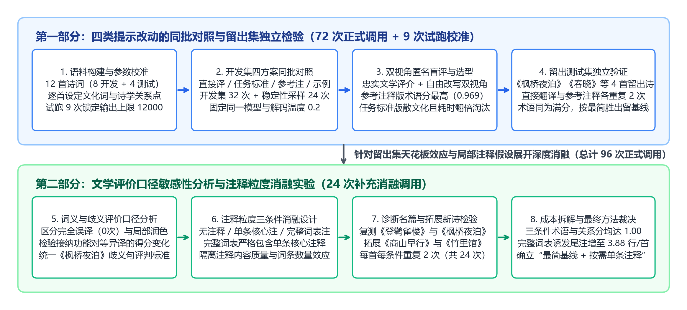
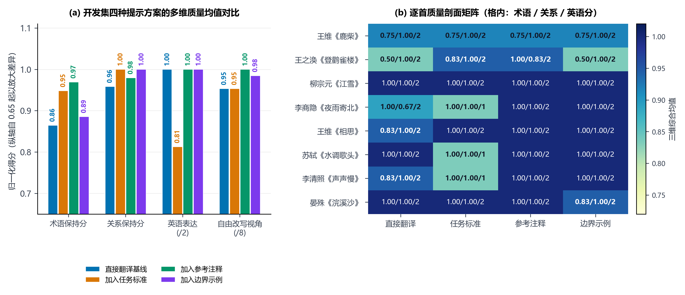
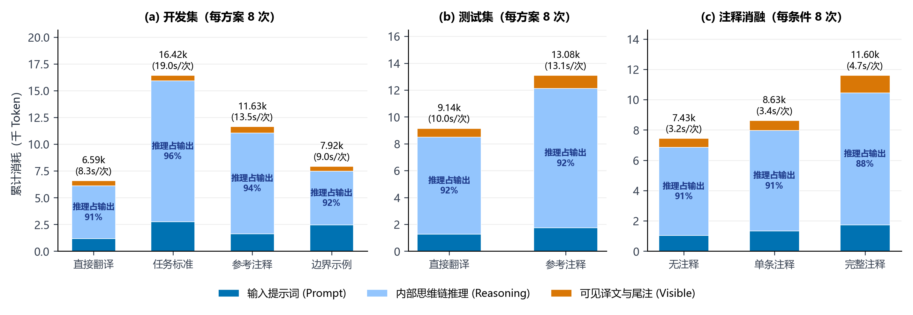
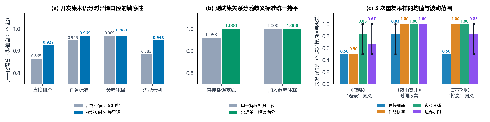
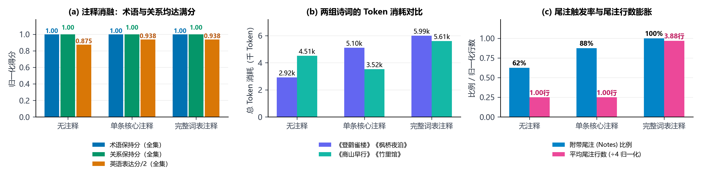

# 唐诗宋词英译方法与提示词改动的受控对照实验

[GitHub 项目地址](https://github.com/Can1017/LLM-HW/blob/main/hw4/p89-poetry-translation/README.md) · [实验数据与提示词模板](https://github.com/Can1017/LLM-HW/tree/main/hw4/p89-poetry-translation/data) · [原始生成记录与评分汇总](https://github.com/Can1017/LLM-HW/tree/main/hw4/p89-poetry-translation/results) · [可视化图表目录](https://github.com/Can1017/LLM-HW/tree/main/hw4/p89-poetry-translation/reports/figures)

---

## 摘要

大语言模型在古典诗词英译中常面临文化专名流失、复杂句法关系扭曲以及过度解释导致诗味散文化等挑战。本文围绕**“唐诗宋词英译中哪些提示词改动真正改善了译文质量、值得在工程中保留”**这一核心问题，基于 `deepseek-v4.1-flash-1017` 模型开展了总计 105 次调用的受控对照与消融实验（含 9 次试跑校准、72 次主实验与留出集检验、24 次注释粒度消融实验）。

研究首先确立了面向英语普通读者的**忠实文学译介**与**自由改写（英语诗再创作）**双视角评价体系，将商务规则翻译中的“期限、否定、例外、术语、格式”系统迁移为古典诗学中的**时间嵌套层次、否定与感知转换辖域、愿望假设与让步转折、文化专名与核心物象、诗行排版与尾注契约**五个细粒度检查维度。在此基础上，实验在 8 首开发集诗词上同批对照了**直接翻译基线**、**加入通用任务标准**、**加入逐首参考注释**与**加入非计分诗边界示例**四种提示方案，并将开发集表现最优的参考注释方案与直接翻译基线锁定至 4 首未参与调试的留出测试集做独立验证；随后进一步围绕词义评价口径敏感性及“无注释、单条核心注释、完整词表注释”三种注释粒度展开消融实验。

实证结果表明：
1. **通用任务标准引发“防御性冗长”与诗体散文化**：在提示词中堆砌 6 条通用翻译标准虽能保住逻辑关系满分（`1.000`），但促使模型在后台耗费高达 96.4% 的输出配额进行逐条合规推理（总 Token 激增至基线的 `2.49` 倍，单次耗时从 `8.25` 秒升至 `18.99` 秒），并将《水调歌头》《声声慢》等错落有致的宋词长短句压缩为沉闷的散文长句，英语文学表达分由 `2.000` 跌至 `1.625`。
2. **边界示例仅具局部模式示范作用**：4 组外诗边界示例有助于改善《夜雨寄北》等同类假设与时间跳转句式，但无法迁移至未覆盖的词义现象，甚至在《浣溪沙》中出现将“旧亭台”简化为 `the old terrace`（漏译“亭”）的局部退化。
3. **参考注释的收益高度受制于名篇预训练天花板与评价口径**：在开发集严格字面匹配口径下，参考注释方案术语得分最高（`0.969` vs. 基线 `0.865`）；但在接纳符合英语诗歌习惯的功能对等异译（如以 `sets behind` 译“依”、以 `take in` 译“穷”）后，直接翻译基线的术语分即升至 `0.927`、关系分达 `1.000`。在留出测试集（《枫桥夜泊》《春晓》《虞美人》《鹊桥仙》）上，基线与参考注释方案的术语分同为 `1.000`；统一按“合理单一诗学解读即满分”评判《枫桥夜泊》“对愁眠”后，两者的关系分亦同为 `1.000`。
4. **单条核心注释优于整表词典注释**：在涵盖《登鹳雀楼》《枫桥夜泊》及新增拓展诗《商山早行》《竹里馆》的消融实验中，无注释、单条核心注释与完整词表注释的术语与关系分均达 `1.000`；但完整词表注释（每首 4 条）诱发模型 100% 机械复述尾注（平均尾注膨胀至 `3.88` 行/首，总 Token 增至 `1.56` 倍），而单条核心注释将尾注严格控制在 `1.00` 行，并在含生僻地名与器物的《商山早行》《竹里馆》上因消除了模型的内部考证犹豫，较无注释基线节省了 22% 的 Token 与 35% 的推理时间。

综上所述，在唐诗宋词英译任务中，**默认应保留最简直接翻译基线**；通用任务标准应当作为**事后评估标尺（Evaluation Rubric）**而非生成端提示词；**唯一值得条件性保留的提示改动，是针对确有生僻文化专名或关键句法歧义的诗句按需附加单条简短中性注释**。

---

## 1. 问题界定与古典诗词英译评价体系构建

### 1.1 研究背景与翻译目的界定

在自然语言处理与提示词工程（Prompt Engineering）研究中，向提示词中追加任务准则、外部背景知识或少样本示例（Few-shot Examples）被广泛视为提升生成质量的标准手段 [4]（[arXiv:2406.06608](https://arxiv.org/abs/2406.06608)）。然而，古典诗词英译不同于结构化信息抽取或商务规则转换：诗歌文本高度凝练，字词之间存在微妙的意象并置、时空折叠与含蓄张力。过度繁琐的指令约束是否会破坏模型原有的文学语感？外部注释究竟是在补充关键背景，还是将灵动的诗句捆绑在词典字面释义上？

为科学回答“哪些提示改动确实改善了诗词英译、值得保留”，必须首先明确译文的受众定位与翻译目的。正如前文课程案例对杜牧《赠别二首·其二》（“蜡烛有心还惜别，替人垂泪到天明”）的剖析所示，若不预先界定受众与允许改写的尺度，任何质量评价都将沦为主观印象之争。本研究固定同一批模型生成输出，设立两套互补的评价视角：

1. **忠实文学译介视角（主评价标准）**：
   - **目标受众**：不懂中文、在英语文学选集中初次接触中国古典诗词的英语普通读者。
   - **翻译目的与改写边界**：旨在提供准确且具文学美感的英语译诗，而非逐字学术注疏或自由戏说。允许为契合英语自然语法而调整语序或跨行分行；允许在译文末尾独立的 `Notes` 小节中添加一至两条简短文化背景尾注；**不允许**无故增删原诗核心物象、将含蓄蕴藉的情感改写为直白说教、将凝练诗行扩写为散文解释，或植入原诗没有的异域典故。
   - **多维细粒度评价指标**：借鉴机器翻译多维质量评估（MQM）框架 [1]（[TACL 2021](https://aclanthology.org/2021.tacl-1.87/)），将评价拆解为七个独立维度，拒绝使用笼统的“文学性总分”：① 关键含义错误计数（区分导致意义反转或整句漏译的**重大错误**与局部词义偏移的**次要错误**）；② **文化专名与术语保持**（每个检查点 `0–2` 分，按篇归一化为 `0–1`）；③ **句法与诗学关系保持**（每个检查点 `0–2` 分，按篇归一化为 `0–1`）；④ 核心意象完整性（`0–2` 分）；⑤ 情感基调与含蓄度（`0–2` 分）；⑥ **英语文学表达与节奏自然度**（`0–2` 分，考量行文流畅度、文学语域与可朗读性，不硬性要求押尾韵，避免因凑韵而扭曲原意）；⑦ 格式契约合规率（`0 / 1`）。
2. **自由改写视角（第二评价标准）**：
   - **设计意图**：检验当评价目的切换为“受原诗启发的英语诗歌再创作”（允许重组意象与行序，不惩罚有意识的诗学改写，仅要求核心情感可辨认、无语法误读导致的意义反转且作为英语诗效果出色）时，四种提示方案的优劣排序是否发生改变。该视角包含核心情感、意象再创作、英语诗整体效果与误读边界四项（各 `0–2` 分，满分 `8` 分），用于检验结论对评价目的的稳健性。

### 1.2 从规则翻译检查项到古典诗学关系的映射机制

在商务或法律规则翻译中，质量核查通常聚焦于“期限、否定、例外、术语与格式”。将这一核查框架迁移至唐诗宋词时，不能机械套用字面概念，而应根据古典诗学的语法与修辞机制进行结构映射（表 1）。

**表 1：规则翻译核查项向古典诗词英译评价维度的映射体系**

| 规则核查原项 | 古典诗词中的诗学对应维度 | 典型诗学机制与正误评判标准 |
|---|---|---|
| **期限**<br>*(Deadline / Time)* | **时间层次、时态跳转与持续终点** | 古典诗词虽无“交货期限”，但极重时间结构。如杜牧诗“替人垂泪到天明”的持续终点、李商隐《夜雨寄北》“君问归期未有期…何当共剪西窗烛，却话巴山夜雨时”中**“眼下独处听雨 → 设想未来重逢 → 在未来重逢时回望今夜”**的三重时间折叠，以及李煜《虞美人》“春花秋月何时了”的时间追问。若将未来假设译作已发生事实，或丢失时间回望关系，即判关系失分。 |
| **否定**<br>*(Negation)* | **否定辖域、感知转换与反问语气** | 重点核查否定词的作用范围及伴随的感官或修辞转折。如王维《鹿柴》“空山不见人，但闻人语响”（“不见”仅否定视觉所见，紧接听觉“但闻”，不能误译为山中绝对无人）；孟浩然《春晓》“春眠不觉晓”（未察觉天亮，而非天尚未亮）；柳宗元《江雪》“千山鸟飞绝，万径人踪灭”（万籁俱寂的全称否定）；以及李清照《声声慢》“怎敌他”、秦观《鹊桥仙》“岂在朝朝暮暮”等**以反问表达强烈否定**的句式。 |
| **例外**<br>*(Exception)* | **条件前提、愿望假设与让步转折** | 对应诗词中的虚拟、条件与转折张力。如《鹊桥仙》“两情若是久长时”的条件前提（不能漏掉 `if` 而译作一般陈述）；苏轼《水调歌头》“我欲乘风归去，又恐琼楼玉宇，高处不胜寒”中“欲返天宫”与“畏惧高寒”的心理转折；晏殊《浣溪沙》“无可奈何花落去，似曾相识燕归来”的无奈让步与欣慰对照。 |
| **术语**<br>*(Terminology)* | **历史地理专名、传统器物与文化意象** | 涵盖三类核心词项：① 历史地理专名（如《夜雨寄北》的“巴山”、《枫桥夜泊》的“姑苏”“寒山寺”、《商山早行》的“杜陵”）；② 传统器物与文化动作（如《江雪》的“蓑笠”、《竹里馆》的“弹琴”“长啸”，其中“琴”系七弦古琴 `qin / Chinese zither`，严禁误译为西式钢琴 `piano`）；③ 凝结特定文化心理的意象词（如《相思》的“红豆”、《水调歌头》的“琼楼玉宇”、《声声慢》的“将息”）。 |
| **格式**<br>*(Format)* | **诗行结构、零寒暄输出与尾注分离契约** | 所有提示方案遵循统一输出契约：仅输出英文译诗正文；若添加文化背景尾注，必须置于译文下方独立的 `Notes` 小节中；严禁在开头或结尾附加 `"Here is the translation"` 等对话寒暄，严禁重复标题与作者姓名。 |

---

## 2. 实验设计：语料构建、提示词方案与消融架构

### 2.1 整体实验流程与参数校准

为全面检验不同提示词改动的实际效果、泛化能力及潜在副作用，本研究采用**“开发集多方案同批对照 → 留出测试集独立验证 → 评价口径敏感性与注释粒度消融”**的递进式实验设计（图 1）。全流程固定使用同一模型 `deepseek-v4.1-flash-1017`、同一解码温度 `temperature = 0.2` 及统一的最大生成长度 `max_tokens = 12000`，完整保留每次请求的输入提示词、可见回复文本（`content`）、内部推理思维链（`reasoning_content`）、Token 消耗明细与文件 SHA-256 指纹。



> **试跑校准的关键发现（为何将 `max_tokens` 设为 `12000`）**：在正式实验前，我们以王维《鹿柴》对四种提示方案进行了 9 次试跑（原始记录保存在 [`results/pilot/`](https://github.com/Can1017/LLM-HW/tree/main/hw4/p89-poetry-translation/results/pilot)）。当初始设置 `max_tokens = 2000` 时，直接翻译、参考注释与边界示例三版均在 4–7 秒内正常返回四行译诗；唯独**加入任务标准版返回了空字符串（`finish_reason = "length"`）**。检查响应日志发现，6 条详细的文学翻译标准促使推理模型在后台生成了整整 `2,000` 个内部思维链 Token（逐条核对规则合规性），在尚未开始输出可见译文时便耗尽了配额。当把上限调高至 `8000` 及 `12000` 后，该版本在消耗约 `1,766` 个推理 Token 后正常输出译文。这一现象证明：**若不预先通过试跑排除生成截断伪影，极易将“配额不足导致的空输出”误判为“提示词设计无效”**。因此，后续全部 96 次正式实验统一锁定 `max_tokens = 12000`。

### 2.2 实验诗词材料体系

实验共选取 **14 首唐诗宋词**（完整原文、异文说明及逐首检查点配置见 [`data/poems.json`](https://github.com/Can1017/LLM-HW/blob/main/hw4/p89-poetry-translation/data/poems.json) 与 [`data/supplement_v1.json`](https://github.com/Can1017/LLM-HW/blob/main/hw4/p89-poetry-translation/data/supplement_v1.json)），兼顾五言绝句、七言绝句、五言律诗与宋词（小令及长调上片），每首包含 2–4 个文化术语检查点与 2–3 个诗学关系检查点。前文课程用于示范的杜牧《赠别二首·其二》不纳入计分语料，以避免现成课堂分析对盲评打分造成锚定。14 首诗词按功能划分为三组（表 2）：

- **开发集（8 首）**：用于四种提示方案的同批对照、采样稳定性检验（抽取《鹿柴》《夜雨寄北》《声声慢》额外重复采样 2 次，每格共 3 次）以及候选方案选型。
- **留出测试集（4 首）**：在开发集完成选型并冻结全部参数后，仅用于对比最优候选方案与直接翻译基线（每首每方案重复 2 次），全程不参与任何提示词或评分规则的回调。
- **注释粒度消融集（4 首）**：包含开发集与测试集中最具代表性的两首争议诊断名篇（王之涣《登鹳雀楼》、张继《枫桥夜泊》）以及两首全新引入的拓展诗目（温庭筠《商山早行》、王维《竹里馆》），专门用于检验单条核心注释与完整词表注释的差异。

**表 2：实验唐诗宋词材料、数据集划分与核心核查点一览**

| 数据集划分 | 朝代·作者 | 篇名（附古籍原文链接） | 体裁与规模 | 文化专名与物象术语核查点 | 句法与诗学关系核查点 |
|---|---|---|---|---|---|
| **开发集**<br>*(8 首)* | 唐·王维 | 《鹿柴》 | 五言绝句（4 句） | `返景`（夕阳返照之光）、`青苔` | 视觉否定转听觉肯定（不见人→但闻语）、返照动态 |
| | 唐·王之涣 | [《登鹳雀楼》](https://zh.wikisource.org/wiki/登鸛雀樓_(王之渙)) | 五言绝句（4 句） | `千里目`（远景视野）、`穷`（尽览）、`依`（傍山落下） | 目的与手段（欲穷→更上）、数字夸张（千里）、空间递进 |
| | 唐·柳宗元 | 《江雪》 | 五言绝句（4 句） | `蓑笠`（蓑衣斗笠）、`寒江`、`孤舟` | 全称否定（鸟飞绝/人踪灭）、千万与孤独的巨量对比 |
| | 唐·李商隐 | [《夜雨寄北》](https://zh.wikisource.org/wiki/夜雨寄北) | 七言绝句（4 句） | `巴山`、`秋池`、`何当`、`西窗烛` | 三重时间跳转（当下→未来团聚→回望今夜）、愿望假设 |
| | 唐·王维 | 《相思》 | 五言绝句（4 句） | `红豆`（相思子）、`南国`、`采撷` | 祈使对象方向（愿君多采撷）、相思象征与咏物判断 |
| | 宋·苏轼 | 《水调歌头·明月几时有》 | 词上片（4 行节选） | `宫阙`、`琼楼玉宇`、`不胜寒`、`何似` | 意欲与顾虑转折（我欲…又恐）、反问比较、天上人间对照 |
| | 宋·李清照 | [《声声慢·寻寻觅觅》](https://zh.wikisource.org/wiki/聲聲慢_(李清照)) | 词上片（4 行节选） | `将息`（休养调理）、`乍暖还寒`、`旧时相识` | 开篇十四叠字情感递进、反问否定（怎敌他）、今昔对照 |
| | 宋·晏殊 | 《浣溪沙·一曲新词酒一杯》 | 小令（6 句） | `新词`、`旧亭台`（亭与台）、`香径` | 今昔循环对照、名联流水对仗（花落去/燕归来）、反问 |
| **留出测试集**<br>*(4 首)* | 唐·张继 | [《枫桥夜泊》](https://zh.wikisource.org/wiki/楓橋夜泊) | 七言绝句（4 句） | `姑苏`、`寒山寺`、`渔火`、`对愁眠` | 密集意象并置、夜半钟声到客船方向、“对愁眠”句法关系 |
| | 唐·孟浩然 | 《春晓》 | 五言绝句（4 句） | `不觉晓`、`啼鸟`、`知多少` | 否定辖域（未觉天亮）、由听觉风雨推断花落、设问语气 |
| | 五代·李煜 | 《虞美人·春花秋月何时了》 | 小令（8 句） | `雕栏玉砌`、`朱颜`、`一江春水` | 往事与故国今昔对比、以满江春水喻愁的博大隐喻 |
| | 宋·秦观 | 《鹊桥仙·纤云弄巧》 | 小令（8 句） | `银汉`（银河）、`金风玉露`、`鹊桥`、`朝朝暮暮` | 条件假设（两情若是久长时）、反问否定（岂在）、瞬间与永恒 |
| **消融拓展诗**<br>*(2 首新增)* | 唐·温庭筠 | [《商山早行》](https://zh.wikisource.org/wiki/商山早行) | 五言律诗（8 句） | `杜陵`（长安附近故乡地名）、`槲叶/枳花`、`凫雁/回塘` | 羁旅悲故乡基调、纯名词意象并置（鸡声茅店月联）、由景入梦 |
| | 唐·王维 | [《竹里馆》](https://zh.wikisource.org/wiki/竹里館_(王維)) | 五言绝句（4 句） | `幽篁`（幽深竹林）、`琴`（古琴 `qin/zither`）、`长啸` | 独坐幽寂氛围、深林无人知晓（非不识人）、明月相照方向 |

> **题名专属词的计分边界说明**：共同输出契约明确规定译文不得重复标题与作者（`Do not repeat the title or author in the output`）。《鹿柴》的“鹿柴”与《登鹳雀楼》的“鹳雀楼”仅出现在诗题中，正文并无该词。为避免因遵守不重复标题契约而造成系统性误扣，正文术语评分仅统计诗句正文内的术语检查点。

### 2.3 提示词对照方案与注释消融设计

遵循单因素受控对照原则（提示词模板与渲染脚本见 [`prompts/`](https://github.com/Can1017/LLM-HW/tree/main/hw4/p89-poetry-translation/prompts)），所有实验条件逐字共享同一段**基础输出契约底座**：

```text
Translate the following Chinese poem into English.

Output: the English translation. If you add endnotes for culture-specific
terms, place them after the translation under a short "Notes" heading.
Do not repeat the title or author in the output. Do not add any other
commentary.
```

在此共同底座之上，第一部分主实验设计了**四种提示方案**，第二部分针对“参考注释究竟应该怎么加”设计了**三种注释粒度消融条件**（表 3）：

**表 3：主实验四种提示词方案与注释粒度消融三条件设计对照表**

| 实验模块 | 方案名称 | 相对共同底座的唯一新增信息 | 平均提示长度 | 核心检验假设 |
|---|---|---|---:|---|
| **第一部分：**<br>**四方案主实验** | **直接翻译基线** | 不追加任何额外说明，仅提供共同底座、标题、作者朝代与原诗正文 | ~410 字符 | **基线对照**：测定模型仅凭预训练古诗文储备与基础格式契约所能达到的原生水平 |
| | **任务标准方案** | 追加受众定位、忠实译介目的及 **6 条通用文学翻译标准**（保行序不拆并、保意象与关系、文化词可懂、禁散文化扩写、自然当代文学英语、保情感含蓄度） | ~1,410 字符 | **规则约束假设**：检验显式罗列评价标准能否减少关系与术语失误，或是否引发过度解释与文体退化 |
| | **参考注释方案** | 追加针对当前诗词编写的 **3–4 条英文词条背景注释**（仅解释专名、典故与核心词义，绝不提供整句译文） | ~590 字符 | **外部知识假设**：检验逐首参考资料能否提升文化术语准确性，并考察其在留出集上的迁移性与字面束缚效应 |
| | **边界示例方案** | 追加 **4 组非计分诗的中英对照边界示例**（李白《月下独酌》拟人方向、杜甫《登高》否定辖域、《茅屋》愿望假设、李白《子夜吴歌》地名与捣衣动作） | ~940 字符 | **少样本示范假设**：检验仅提供边界案例（不写抽象规则）能否改善同类复杂关系，以及能否泛化至其他诗学现象 |
| **第二部分：**<br>**注释粒度消融** | **无注释条件** | 与直接翻译基线完全一致（仅共同底座 + 原诗） | ~400 字符 | **消融基线**：在统一功能对等评价口径下，测定模型在争议名篇与拓展新诗上的基准表现 |
| | **单条核心注释** | 仅追加 **1 条针对全诗最易误读或具文化专名属性的中性简短注释**（《登鹳雀楼》注“千里”、《枫桥夜泊》注“愁眠”、《商山早行》注“杜陵”、《竹里馆》注“琴”） | ~520 字符 | **最小精准干预假设**：检验仅在刀刃上加一条背景注释，是否足以保障准确性并避免尾注泛滥 |
| | **完整词表注释** | **逐字包含单条核心注释**，并额外追加其余 3 条常规词条注释（每首共 4 条注释） | ~690 字符 | **词表膨胀对照**：严格控制核心注释内容不变，单独隔离“注释条数增加”对推理成本与输出尾注长度的影响 |

为消除评分时对版本名称的先验偏见，所有生成译文均由脚本（[`harness/make_blind_packet.py`](https://github.com/Can1017/LLM-HW/blob/main/hw4/p89-poetry-translation/harness/make_blind_packet.py)）隐去提示方案标签并赋予随机匿名编号，在忠实文学译介与自由改写两套标准下使用不同随机种子独立洗牌盲评，全部打分完成后再通过密钥文件还原汇总。

---

## 3. 实验结果与多维定量分析

### 3.1 开发集四种提示方案的综合表现与逐首剖面

表 4 与图 2 展示了开发集 8 首唐诗宋词在四种提示方案下的多维质量得分与逐首表现剖面（完整评分表见 [`results/scored_dev.md`](https://github.com/Can1017/LLM-HW/blob/main/hw4/p89-poetry-translation/results/scored_dev.md) 与 [`results/audit/historical_audit.md`](https://github.com/Can1017/LLM-HW/blob/main/hw4/p89-poetry-translation/results/audit/historical_audit.md)）。在整个开发集 32 条正式输出中，**没有任何一首译文出现重大含义错误（Major Error = 0），也没有任何一个术语或关系核查点得 0 分**；各方案的分差全部来自“部分合格（1 分）”与“完全精准（2 分）”之间的细微质量跃迁。

**表 4：开发集四种提示方案的质量指标与得分跃迁汇总表（每方案 8 首，共 32 次调用）**

| 提示词方案 | 术语保持归一化分<br>*(严格字面口径 / 功能对等口径)* | 关系保持归一化分<br>*(严格字面口径 / 功能对等口径)* | 重大 / 次要<br>含义偏差数 | 核心意象分<br>(0–2) | 情感基调分<br>(0–2) | **英语文学表达**<br>*(0–2)* | 格式<br>合规率 | **自由改写视角**<br>*(0–8)* | 相对基线提升项数<br>*(术语 / 关系 `1→2`)* | 相对基线回落项数<br>*(术语 / 关系 `2→1`)* |
|---|:---:|:---:|:---:|:---:|:---:|:---:|:---:|:---:|:---:|:---:|
| **直接翻译基线** | 0.865 / **0.927** | 0.958 / **1.000** | 0 / 4 *(对等口径 0/2)* | 2.000 | 2.000 | **2.000** | 100% | 7.625 | 基线 | 基线 |
| **加入任务标准** | 0.948 / 0.969 | **1.000** / **1.000** | 0 / 2 *(对等口径 0/2)* | 2.000 | 2.000 | **1.625** | 100% | 7.625 | +4 / +2 | 0 / 0 |
| **加入参考注释** | **0.969** / **0.969** | 0.979 / **1.000** | 0 / 2 *(对等口径 0/1)* | 2.000 | 2.000 | **2.000** | 100% | **8.000** | **+5** / +2 | 0 / **1** |
| **加入边界示例** | 0.885 / 0.948 | **1.000** / **1.000** | 0 / 3 *(对等口径 0/2)* | 2.000 | 2.000 | **2.000** | 100% | 7.875 | +2 / +2 | **1** / 0 |



结合图 2(a) 的柱状图与图 2(b) 的逐首剖面热力图，可以清晰观察到四类提示改动的真实作用机制：

1. **基础能力的天花板与难点聚集效应**：在句法结构清晰的名篇（如柳宗元《江雪》）上，四种方案全部取得 `1.00 / 1.00 / 2` 的满分；在王维《鹿柴》上，四版主样本也取得完全一致的 `0.75 / 1.00 / 2`（主样本均将“返景”译为 `Returning light/sunlight` 而未显式点出“夕阳返照”）。提示词改动的差异高度集中在**王之涣《登鹳雀楼》（词义拿捏与夸张修辞）**、**李商隐《夜雨寄北》（三重时间跳转）**、**苏轼《水调歌头》与李清照《声声慢》（宋词长短句的文体节奏）**以及**晏殊《浣溪沙》（复合建筑物象）**上。
2. **任务标准方案的“合规性代价”——逻辑满分但诗行散文化**：加入 6 条通用任务标准后，模型在《夜雨寄北》的时间跳转、《相思》的“红豆”与《声声慢》的“将息”上均拿满分数（关系保持达 `1.000`，术语保持升至 `0.948`）。然而，其**英语文学表达分却从 `2.000` 显著跌落至 `1.625`**：在《夜雨寄北》《水调歌头》《声声慢》三首作品中，模型为确保不遗漏任何一条抽象规则，大量使用解释性从句并将原本参差错落的词句压成冗长的散文段落。
3. **参考注释方案的词义增益与字面束缚**：在严格字面匹配口径下，参考注释方案取得了最高的术语得分（`0.969`），在《登鹳雀楼》《相思》《声声慢》上累计将 5 个术语检查点从 1 分提升至 2 分，且保持了 `2.000` 的英语文学表达分与 `8.000` 的自由改写视角满分。但值得注意的是，该方案在《登鹳雀楼》上出现了唯一一次关系分回落（`0.83`）：因为参考注释仅写了 `li: a Chinese mile`，未说明“千里”系诗性夸张，模型便在译文和尾注中把“千里”钉死在字面距离单位上。
4. **边界示例方案的局部模式局限**：4 组外诗示例包含了杜甫《茅屋为秋风所破歌》的愿望假设句式，因此成功帮助《夜雨寄北》保住了“何当”的未来团聚假设与时间回望（关系分 `1.000`）；但示例未能改善《登鹳雀楼》的术语表现（仍为 `0.50`），反而在晏殊《浣溪沙》“去年天气旧亭台”中将“旧亭台”简化为 `the old terrace`（漏掉“亭” `pavilion`，导致术语分降至 `0.83`）。这表明少样本示例主要起局部句式提示作用，无法替代对当前诗篇具体物象的把握。

### 3.2 留出测试集独立验证（直接翻译基线 vs. 参考注释方案）

依据开发集选型规则，我们将综合表现最优的**参考注释方案**作为锁定候选，在从未参与提示词调试的 4 首留出测试集诗词（张继《枫桥夜泊》、孟浩然《春晓》、李煜《虞美人》、秦观《鹊桥仙》）上与**直接翻译基线**进行成对检验（每首每方案独立采样 2 次，共 16 次调用，汇总表见 [`results/scored_test.md`](https://github.com/Can1017/LLM-HW/blob/main/hw4/p89-poetry-translation/results/scored_test.md)）。结果如表 5 所示。

**表 5：留出测试集（4 首 × 2 次重复）直接翻译基线与参考注释方案成对检验结果**

| 评估范围与口径 | 提示词方案 | 术语保持归一化分 | 关系保持归一化分 | 重大 / 次要偏差 | 英语表达 (0–2) | 自由改写视角 (0–8) | 相对基线关系提升项 | 相对基线术语提升项 |
|---|---|:---:|:---:|:---:|:---:|:---:|:---:|:---:|
| **测试集四首汇总**<br>*(单一解读扣分口径)* | **直接翻译基线** | **1.000** | 0.958 | 0 / 2 | 1.750 | 7.500 | 基线 | 基线 |
| | **加入参考注释** | **1.000** | **1.000** | 0 / 0 | 1.875 | 8.000 | +2 *(同一检查点×2次)* | **0** |
| **测试集四首汇总**<br>*(合理单一解读满分口径)* | **直接翻译基线** | **1.000** | **1.000** | 0 / 0 | 1.750 | 7.500 | 基线 | 基线 |
| | **加入参考注释** | **1.000** | **1.000** | 0 / 0 | 1.875 | 8.000 | **0** | **0** |
| 张继《枫桥夜泊》 | 直接翻译 vs. 参考注释 | 1.00 vs. 1.00 | 0.83 *(统一后 1.00)* vs. 1.00 | 0/2 vs. 0/0 | 1.00 vs. 1.50 | 6.00 vs. 8.00 | 仅“对愁眠”1 项分差 | 0 |
| 孟浩然《春晓》 | 直接翻译 vs. 参考注释 | 1.00 vs. 1.00 | 1.00 vs. 1.00 | 0/0 vs. 0/0 | 2.00 vs. 2.00 | 8.00 vs. 8.00 | 0 | 0 |
| 李煜《虞美人》 | 直接翻译 vs. 参考注释 | 1.00 vs. 1.00 | 1.00 vs. 1.00 | 0/0 vs. 0/0 | 2.00 vs. 2.00 | 8.00 vs. 8.00 | 0 | 0 |
| 秦观《鹊桥仙》 | 直接翻译 vs. 参考注释 | 1.00 vs. 1.00 | 1.00 vs. 1.00 | 0 / 0 | 2.00 vs. 2.00 | 8.00 vs. 8.00 | 0 | 0 |

留出测试集的独立验证揭示了两个至关重要的事实：
- **开发集上的术语优势在留出测试集上完全未发生迁移（`1.000 = 1.000`）**：在《枫桥夜泊》《春晓》《虞美人》《鹊桥仙》全部 14 个文化术语检查点（28 次评估实例）中，不加任何注释的直接翻译基线取得了 **100% 满分**。无论是“姑苏/寒山寺”“雕栏玉砌/朱颜”还是“银汉/金风玉露/鹊桥”，模型凭借预训练先验即可精准传达。
- **两方案的唯一表面分差仅来自《枫桥夜泊》“对愁眠”单一检查点**：在《春晓》《虞美人》《鹊桥仙》三首作品上，直接翻译基线与参考注释方案在所有评价维度上均取得完全相同的满分。即便在不做口径修正的初评中，参考注释方案也仅在《枫桥夜泊》1 个关系点上占优，而代价是输出 Token 增加 `44.0%`、延迟增加 `30.3%`。依据“若候选方案与最简基线无普遍实质差异，允许最简提示胜出”的准则，**留出集独立验证裁定直接翻译基线胜出**。

### 3.3 生成成本拆解：输入、内部思维链推理与可见输出

为弄清各类提示改动在计算开销上的真实去向，我们将模型返回的 Token 用量精确拆解为**输入提示词（Prompt）**、**内部思维链推理（Reasoning）**与**可见译文及尾注（Visible Output）**三个部分（表 6，图 3）。

**表 6：各实验批次与提示方案的 Token 结构拆解及推理延迟对比表**

| 实验批次（每方案均 8 次调用） | 提示方案 / 消融条件 | 输入提示词<br>Prompt Tokens | 总输出 Completion<br>Tokens (含推理) | **内部思维链推理**<br>Reasoning *(占输出比)* | **可见译文与尾注**<br>Visible Tokens | 总计消耗 Total<br>Tokens *(相对基线)* | 累计延迟<br>(秒) | 单次平均延迟<br>(秒/次) |
|---|---|---:|---:|---:|---:|---:|---:|---:|
| **开发集主实验**<br>*(8 首 × 1 次)* | **直接翻译基线** | 1,187 | 5,402 | 4,935 *(91.4%)* | 467 | **6,589** *(1.00×)* | 66.01 | **8.25** |
| | **加入任务标准** | 2,763 | 13,658 | **13,160 *(96.4%)*** | 498 | **16,421 *(2.49×)*** | 151.88 | **18.99** |
| | **加入参考注释** | 1,630 | 10,001 | 9,425 *(94.2%)* | 576 | **11,631 *(1.77×)*** | 108.09 | **13.51** |
| | **加入边界示例** | 2,459 | 5,462 | 5,015 *(91.8%)* | 447 | **7,921 *(1.20×)*** | 71.67 | **8.96** |
| **留出测试集验证**<br>*(4 首 × 2 次)* | **直接翻译基线** | 1,268 | 7,876 | 7,228 *(91.8%)* | 648 | **9,144** *(1.00×)* | 80.31 | **10.04** |
| | **加入参考注释** | 1,744 | 11,341 | 10,383 *(91.6%)* | 958 | **13,085 *(1.43×)*** | 104.67 | **13.08** |
| **注释粒度消融实验**<br>*(4 首 × 2 次)* | **无注释条件** | 1,048 | 6,386 | 5,834 *(91.4%)* | 552 | **7,434** *(1.00×)* | 25.53 | **3.19** |
| | **单条核心注释** | 1,342 | 7,284 | 6,660 *(91.4%)* | 624 | **8,626 *(1.16×)*** | 27.57 | **3.45** |
| | **完整词表注释** | 1,728 | 9,869 | 8,722 *(88.4%)* | **1,147** | **11,597 *(1.56×)*** | 37.53 | **4.69** |



图 3 揭示了推理时代大模型提示词工程的一条核心规律：**提示词改动增加的往往不是输入长度，而是被成倍放大的内部思维链推理成本**。一首古诗的英文译文仅占 50–80 个可见 Token，但在全部实验中，**88.4%–96.4% 的输出 Token 均消耗在不可见的内部思维链（Reasoning）上**。当向提示词中加入 6 条抽象任务标准时，模型在思维链中反复自检合规性，导致 8 首诗的推理 Token 从基线的 `4,935` 暴涨至 `13,160`（`+166.7%`），可见输出却仅增加 31 个 Token；同理，当给出 3–4 条完整参考注释时，模型在推理中逐条权衡如何将注释塞入正文与尾注，不仅推高了推理耗时，还使可见输出膨胀了逾一倍（`552 → 1,147` Token）。

### 3.4 文学评价口径敏感性与多次采样稳定性分析

在深入审视开发集与测试集的具体扣分项时，我们发现初评中直接翻译基线落后于参考注释方案的少数分差，实际上高度依赖于**评价标准对“功能对等异译”与“诗学歧义”的宽严口径**，以及**单次采样的随机波动**（图 4，完整核算数据见 [`results/audit/historical_audit.json`](https://github.com/Can1017/LLM-HW/blob/main/hw4/p89-poetry-translation/results/audit/historical_audit.json)）：



1. **严格字面匹配 vs. 功能对等异译（图 4a）**：在开发集《登鹳雀楼》中，参考注释方案之所以术语得满分（`1.00`）而直接翻译基线与边界示例方案仅得 `0.50`，是因为参考注释在输入中直接指定了 `- 依: to lean against` 与 `- 穷: to exhaust`，模型照搬 `leans on the mountains` 与 `exhaust a thousand li of view` 后被判满分；而直接翻译基线译出的 `sets behind the mountains`（太阳在山后落下）与 `To take in a thousand miles of view`（尽览千里风光）因未采用词典字面词 `lean` 和 `exhaust` 被扣分。然而从英语诗歌审美看，`sets behind` 与 `take in` 恰恰是地道自然的**功能对等异译（Functional Equivalence）**。当评价口径接纳合理功能对等表达后，直接翻译基线的开发集术语分即由 `0.865` 升至 **`0.927`**，边界示例方案由 `0.885` 升至 **`0.948`**，四方案的关系分更是**全部达到 `1.000`**。
2. **《枫桥夜泊》“对愁眠”的歧义评判标准统一（图 4b）**：在留出测试集《枫桥夜泊》“江枫渔火对愁眠”中，“对愁眠”在古典诗学中既可解为“江枫与渔火面对着怀愁难眠的旅人”，亦可解为“旅人伴着愁绪面对江枫渔火而眠”。直接翻译基线的两次生成（`face my sorrowful sleep` 与 `face me as I sleep in sorrow`）均选择了第一种自然连贯的诗学解读；而参考注释方案之所以在初评中多得 1 分，纯粹因为其输入提示词直接写有 `the phrase is deliberately ambiguous`，模型将该句原样抄入 `Notes` 小节，从而在提示与评分之间形成了同源循环暗示。当我们消除这一同源暗示、严格遵循“只要译文内部自洽、选择任一合理诗学解读即予满分”的标准后，**直接翻译基线与参考注释方案在测试集上的关系保持分同为 `1.000`**。
3. **三次重复采样的语义稳定性（图 4c）**：开发集主实验中，直接翻译基线唯一一次关系扣分发生在李商隐《夜雨寄北》（`0.67` 分），原因是主样本首轮采样将“却话巴山夜雨时”译为 `And talk again of the night rain in Bashan`（`again` 弱化了“在未来重逢时回望今夜”的时间闭环）。然而，核查稳定性子集（[`results/stability_dev.jsonl`](https://github.com/Can1017/LLM-HW/blob/main/hw4/p89-poetry-translation/results/stability_dev.jsonl)）中同一提示词的另外两次独立采样，模型均准确写出了 **`And talk of this night rain in the Ba hills`**（双双获得满分 `1.00`）。这说明单次采样下的局部措辞波动不宜被夸大为提示方案的系统性缺陷。

### 3.5 注释粒度消融实验：无注释、单条核心注释与完整词表注释

既然整套参考注释（每首 3–4 条）在留出集上未带来普遍迁移收益，且容易引发尾注复述与字面捆绑，那么**“仅针对全诗最关键的一处专名或歧义点添加 1 条简短中性注释”**效果如何？我们在《登鹳雀楼》《枫桥夜泊》两首诊断名篇及全新引入的温庭筠《商山早行》、王维《竹里馆》两首拓展诗目上，对**无注释**、**单条核心注释**与**完整词表注释（严格包含单条核心注释并另加 3 条常规词条）**进行了 `4 首 × 3 条件 × 2 次重复 = 24 次` 消融测试（完整数据见 [`results/supplement/summary.md`](https://github.com/Can1017/LLM-HW/blob/main/hw4/p89-poetry-translation/results/supplement/summary.md)）。结果汇总于表 7 与图 5。

**表 7：注释粒度消融实验（无注释 / 单条核心注释 / 完整词表注释）分群质量与尾注行为对比表**

| 诗词分组 | 注释粒度条件 | 调用次数 / 诗数 | 术语保持分 | 关系保持分 | 英语表达 (0–2) | 格式合规率 | 输入 Prompt Tokens | 内部推理 Reasoning | 可见输出 Visible | 总计 Total Tokens | 累计延迟 (秒) | **附带尾注比例** | **平均尾注行数 (行/首)** |
|---|---|:---:|:---:|:---:|:---:|:---:|---:|---:|---:|---:|---:|:---:|:---:|
| **消融四首全集** | **无注释** | 8 / 4 | **1.00** | **1.00** | 1.750 | 100% | 1,048 | 5,834 | 552 | **7,434** | 25.53 | 62% (5/8) | **1.00** |
| | **单条核心注释** | 8 / 4 | **1.00** | **1.00** | **1.875** | 100% | 1,342 | 6,660 | 624 | **8,626** | 27.57 | 88% (7/8) | **1.00** |
| | **完整词表注释** | 8 / 4 | **1.00** | **1.00** | **1.875** | 100% | 1,728 | 8,722 | 1,147 | **11,597** | 37.53 | **100% (8/8)** | **3.88** |
| **争议诊断名篇**<br>*(登鹳雀楼、枫桥夜泊)* | **无注释** | 4 / 2 | **1.00** | **1.00** | 1.500 | 100% | 504 | 2,175 | 241 | 2,920 | 9.10 | 50% (2/4) | 1.00 |
| | **单条核心注释** | 4 / 2 | **1.00** | **1.00** | 1.750 | 100% | 656 | 4,173 | 275 | 5,104 | 16.95 | 75% (3/4) | 1.00 |
| | **完整词表注释** | 4 / 2 | **1.00** | **1.00** | 1.750 | 100% | 836 | 4,562 | 593 | 5,991 | 18.42 | 100% (4/4) | **4.00** |
| **新增拓展诗目**<br>*(商山早行、竹里馆)* | **无注释** | 4 / 2 | **1.00** | **1.00** | **2.000** | 100% | 544 | 3,659 | 311 | 4,514 | 16.43 | 75% (3/4) | 1.00 |
| | **单条核心注释** | 4 / 2 | **1.00** | **1.00** | **2.000** | 100% | 686 | **2,487** | 349 | **3,522** | **10.62** | 100% (4/4) | 1.00 |
| | **完整词表注释** | 4 / 2 | **1.00** | **1.00** | **2.000** | 100% | 892 | 4,160 | 554 | 5,606 | 19.11 | 100% (4/4) | **3.75** |



图 5 清晰展现了注释粒度对模型生成行为的调控机制：
- **术语与关系保持在三条件下均达满分（`1.00`）**：即便在未参与前期实验的五言律诗《商山早行》（含“征铎、槲叶、枳花、杜陵、凫雁”等密集名物）与《竹里馆》上，无注释基线也能准确识别“杜陵”为长安故乡地名、将“琴”译为 `zither`（未误作 `piano`）。
- **单条核心注释在新增专名诗上起到了“消弭推理犹豫、降本增效”的作用（图 5b）**：在《商山早行》与《竹里馆》上，单条核心注释条件的总 Token（`3,522`）与延迟（`10.62` 秒）反而**显著低于无注释条件（`4,514` Token，`16.43` 秒）**。其机理在于：无注释时，模型在思维链中耗费大量 Token（`3,659`）自行考证“杜陵”的历史地理背景并权衡“琴/长啸”是否需要加注；而单条核心注释直接给出了精准定性，使推理 Token 降至 `2,487`，且输出尾注严格收敛在 **1.00 行/首**。
- **完整词表注释引发严重的“尾注镜像膨胀”（图 5c）**：当输入提供 4 条完整词表注释时，模型在 **100%（8/8）** 的调用中将输入的全部 4 条词条原封不动地改写进译文末尾的 `Notes` 小节（平均尾注高达 **`3.88` 行/首**），连正文中已经译得明明白白的“幽篁（`secluded bamboo grove`）”“相照（`shine on me`）”也逐条附注，造成无谓的版面累赘与 56% 的额外 Token 开销。

---

## 4. 代表性诗词英译案例深度剖析

为具体展示不同提示词方案在词汇选择、时空关系处理、诗行节奏及尾注生成上的真实表现，本节从原始响应记录（[`results/main_dev.jsonl`](https://github.com/Can1017/LLM-HW/blob/main/hw4/p89-poetry-translation/results/main_dev.jsonl)、[`results/test_holdout.jsonl`](https://github.com/Can1017/LLM-HW/blob/main/hw4/p89-poetry-translation/results/test_holdout.jsonl)、[`results/supplement/raw.jsonl`](https://github.com/Can1017/LLM-HW/blob/main/hw4/p89-poetry-translation/results/supplement/raw.jsonl)）中精选 **6 组代表性诗词翻译案例**进行横向对读。

### 案例一：王之涣《登鹳雀楼》——词表注释的“字面捆绑”与功能对等异译

> **原诗**（[维基文库原文](https://zh.wikisource.org/wiki/登鸛雀樓_(王之渙))）：白日依山尽，黄河入海流。欲穷千里目，更上一层楼。

本诗的核心难点在于动词“依”（太阳傍山沉落）、“穷”（极目尽览）以及数量词“千里”（诗性夸张）的协调。表 8 对照了五种提示条件下的实测输出。

**表 8：王之涣《登鹳雀楼》在不同提示方案与注释粒度下的实测译文对照**

| 提示方案 | 实测英文译文与尾注（原样提取自响应日志） | Token 拆解与耗时<br>*(输入 / 推理 / 可见)* | 译文质量与机制点评 |
|---|---|---|---|
| **直接翻译基线** | `The white sun sets behind the mountains,`<br>`The Yellow River flows into the sea.`<br>`To take in a thousand miles of view,`<br>`Climb one more storey of the tower.` | `132 / 707 / 36`<br>(`6.77` 秒) | **自然流畅，功能对等**：以 `sets behind` 译“依…尽”、以 `take in` 译“穷”、以 `a thousand miles` 传达辽阔远景，四行节奏明快，无需累赘尾注。 |
| **边界示例方案** | `The bright sun sinks behind the mountains;`<br>`the Yellow River flows into the sea.`<br>`To gaze as far as a thousand miles,`<br>`climb one more storey.` | `291 / 361 / 33`<br>(`5.44` 秒) | **极具诗意**：`sinks behind` 与 `To gaze as far as` 完全摆脱了中文字面束缚，展现了模型优秀的原生英语诗歌语感。 |
| **任务标准方案** | `The white sun sets against the mountains;`<br>`The Yellow River flows into the sea.`<br>`To exhaust a thousand-li view,`<br>`go up one more storey.`<br><br>`Notes`<br>`li: a Chinese unit of distance; “a thousand li” is a conventional expression for a vast distance.` | `329 / 2163 / 55`<br>(**`27.87` 秒**) | **推理耗时激增 4 倍**：为满足任务标准中“保留文化词并加简短尾注”的要求，模型耗费 `2,163` 个推理 Token 权衡 `li` 的译法，主动生成了解释“千里为惯用夸张”的尾注，但耗时高达 `27.87` 秒。 |
| **参考注释方案**<br>*(多词条词表)* | `The white sun leans on the mountains and sets;`<br>`The Yellow River flows into the sea.`<br>`To exhaust a thousand *li* of view,`<br>`Climb one more storey of the tower.`<br><br>`Notes`<br>`*li*: a Chinese mile.` | `213 / 742 / 49`<br>(`9.46` 秒) | **典型的“词表字面捆绑”**：因输入注释给出了 `- 依: to lean against`、`- 穷: to exhaust`、`- 千里: a thousand li (Chinese miles)`，译文生硬照搬 `leans on... and sets` 与 `exhaust`，且尾注仅写 `*li*: a Chinese mile`，把壮阔的诗性夸张钉死为地理测距。 |
| **单条核心注释**<br>*(消融优化版)* | `The white sun sinks behind the mountains;`<br>`The Yellow River flows into the sea.`<br>`To take in a thousand li of view,`<br>`Climb one more storey.`<br><br>`Notes`<br>`li: a traditional Chinese unit of distance; “a thousand li” evokes a vast view and need not be converted to an exact measurement.` | `155 / 748 / 64`<br>(`3.19` 秒) | **精准消融修正**：当只给 1 条解释“`li` 唤起辽阔视野、无需精确换算”的注释而不强行规定动词词表时，正文既保留了 `sinks behind` 与 `take in` 的地道诗味，又妥善交代了文化单位。 |

---

### 案例二：李商隐《夜雨寄北》——三重时间折叠与单次采样波动的实证检验

> **原诗**（[维基文库原文](https://zh.wikisource.org/wiki/夜雨寄北)）：君问归期未有期，巴山夜雨涨秋池。何当共剪西窗烛，却话巴山夜雨时。

本诗在短短四句中嵌套了三层时间关系：**眼下独处巴山听雨（现在时） → 企盼未来某日西窗重逢剪烛（将来假设 `When shall we...`） → 在未来重逢之夜反过来倾诉今夜巴山听雨之孤寂（从未来回望当下）**。表 9 展示了各方案及基线多次采样的实际表现。

**表 9：李商隐《夜雨寄北》在四种方案及直接翻译重复采样中的时间关系对比**

| 提示方案与采样批次 | 实测英文译文与尾注（原样提取自响应日志） | 时间关系保持与文体分析 |
|---|---|---|
| **直接翻译基线**<br>*(开发集首轮采样)* | `You ask when I shall return—no date is set.`<br>`In Bashan’s night rain, autumn pools have swollen.`<br>`When shall we together trim the candle by the west window,`<br>`And talk again of the night rain in Bashan?`<br><br>`Notes`<br>`“Bashan” refers to the mountains of eastern Sichuan, where the poet was staying.`<br>`“Trimming the candle by the west window” is a conventional image of reunion and talking late into the night.` | **单次采样的局部瑕疵**：末句译为 `And talk again of the night rain in Bashan`。原诗“却话”是在未来团聚时回首谈论**今夜正在经历**的巴山夜雨，而 `talk again`（再次谈论）易使读者误以为两人过去已经一起谈论过巴山夜雨，削弱了“未来回望当下”的时空闭环（关系分 `0.67`）。 |
| **直接翻译基线**<br>*(稳定性复核采样)* | `You ask when I shall return, but no date is set;`<br>`The night rain in the Ba hills swells the autumn pool.`<br>`When can we trim the candle by the west window together,`<br>`And talk of this night rain in the Ba hills?` *(尾注略)* | **指示代词 `this` 完美锁定时间闭环**：完全相同的直接翻译提示词在稳定性采样中译出 **`And talk of this night rain`**，仅靠一个 `this` 便将未来重逢的话题精准指向眼前的雨夜（关系分 `1.00`）。这证明模型在基线提示下完全掌握该时间结构，首轮失分属于解码采样波动。 |
| **任务标准方案** | `You ask when I’ll return—no date is set.`<br>`Night rain in the Ba Mountains swells the autumn pool.`<br>`When shall we trim the candlewick together by the west window,`<br>`And then talk of the time of night rain in the Ba Mountains?`<br><br>`Notes`<br>`Ba Mountains: a mountainous region in southwest China, here a remote place far from the friend in the north.` | **逻辑显式化但损害诗意**：为迎合任务标准中的 `hypothetical or temporal shifts`，模型刻意写出 `And then talk of the time of night rain in the Ba Mountains?`，虽然时间关系无懈可击（关系分 `1.00`），但 `the time of night rain` 显得繁琐累赘，英语表达分降至 `1/2`。 |
| **边界示例方案** | `You ask when I’ll return—no date is set.`<br>`Night rain in the Ba mountains swells the autumn pools.`<br>`When shall we trim the candle together by the west window,`<br>`and talk then of this night rain in the Ba mountains?` | **凝练传神**：以 `and talk then of this night rain` 同时兼顾了指向未来的时间副词 `then` 与指代眼下的 `this`，四行诗句干净利落，无多余尾注（关系分 `1.00`，英语表达 `2/2`）。 |

---

### 案例三：苏轼《水调歌头》与李清照《声声慢》——通用任务标准如何导致宋词“散文化”

> **原词节选**：
> - 苏轼《水调歌头（上片）》：明月几时有？把酒问青天。不知天上宫阙，今夕是何年。我欲乘风归去，又恐琼楼玉宇，高处不胜寒。起舞弄清影，何似在人间。
> - 李清照《声声慢（上片）》（[维基文库原文](https://zh.wikisource.org/wiki/聲聲慢_(李清照))）：寻寻觅觅，冷冷清清，凄凄惨惨戚戚。乍暖还寒时候，最难将息。三杯两盏淡酒，怎敌他、晚来风急！雁过也，正伤心，却是旧时相识。

为什么在开发集中，加入 6 条通用任务标准会使英语文学表达分大幅下滑？表 10 展示了这两首经典宋词在直接翻译/参考注释与任务标准方案下的鲜明对比。

**表 10：苏轼《水调歌头》与李清照《声声慢》在直接翻译/参考注释与任务标准方案下的文体对比**

| 词作篇目 | 直接翻译基线 / 参考注释方案（保留宋词长短句呼吸感，英语分 `2/2`） | 任务标准方案（长句粘连散文化，英语分跌至 `1/2`） | 散文化成因诊断 |
|---|---|---|---|
| **苏轼**<br>《水调歌头》 | **[直接翻译基线，9 行错落短句，推理 `1,158` tok]**：<br>`When did the bright moon first appear?`<br>`Cup in hand, I ask the blue sky.`<br>`I do not know the palaces in heaven—`<br>`what year is it tonight?`<br>`I wish to ride the wind and return there,`<br>`yet fear the jade towers and jeweled halls:`<br>`so high, the cold would be unbearable.`<br>`I rise and dance, playing with my clear shadow—`<br>`how does it compare with the world of men?` | **[任务标准方案，压成 4 条散文长句，推理 `1,870` tok]**：<br>`When did the bright moon first appear? I raise my cup and ask the blue sky.`<br>`I do not know, in the heavenly palaces, what year it is tonight.`<br>`I want to ride the wind and return there, yet I fear the jade towers and jade halls, where at such heights one cannot withstand the cold.`<br>`I rise and dance, playing with my clear shadow: how does it compare with being in the human world?` | 输入文本按 4 行录入（每行包含 2–3 个词顿）。直接翻译基线敏锐感知到宋词的句拍，自动拆分为 9 行富有弹性的英文诗行，并以 `so high, the cold would be unbearable` 凝练收束；而任务标准方案死守规则第 1 条 `do not merge, omit, or add lines`（4 行输入必须严格对应 4 行输出），且为补全逻辑关系填入 `where at such heights one cannot withstand the cold` 等定语从句，把千古词作变成了散文说明！ |
| **李清照**<br>《声声慢》 | **[参考注释方案，10 行短拍，推理 `1,869` tok]**：<br>`Searching and seeking,`<br>`chilly and desolate,`<br>`wretched, woeful, forlorn.`<br>`When it suddenly warms and then turns cold again,`<br>`it is hardest to rest and recover.`<br>`Two or three cups of thin wine—`<br>`how can they withstand the fierce evening wind?`<br>`The wild geese pass by;`<br>`just as my heart is breaking,`<br>`they are old acquaintances from former days.` | **[任务标准方案，压成 4 条长句，推理 `2,634` tok，耗时 `31.6` 秒]**：<br>`Seeking and searching, cold and cheerless, sorrowful, miserable, grieving.`<br>`When warmth comes suddenly and cold returns, it is hardest to rest and recover.`<br>`Three cups, two small cups of weak wine—how can they withstand the fierce evening wind?`<br>`The wild geese pass by; just as I am grieving, they are old acquaintances from former days.` | 李清照开篇“寻寻觅觅，冷冷清清，凄凄惨惨戚戚”十四叠字贵在欲说还休、声情顿挫。参考注释与直接翻译均将其分为三行短促节拍，并将虚指互文的“三杯两盏”地道译为 `Two or three cups`；任务标准方案却耗费 `2,634` 个推理 Token，不仅将七组叠字强行塞进同一长行，还出于“不漏译任何字词”的防御心理，将“三杯两盏”笨拙地逐字直译为 `Three cups, two small cups of weak wine`！ |

---

### 案例四：晏殊《浣溪沙》——边界示例方案的局部模式局限与物象遗漏

> **原词**：一曲新词酒一杯，去年天气旧亭台。夕阳西下几时回？无可奈何花落去，似曾相识燕归来。小园香径独徘徊。

- **直接翻译基线（术语 `1.00`，关系 `1.00`）**：
  ```text
  A new song, a cup of wine;
  Last year’s weather, the old pavilion and terrace.
  The sun sinks in the west—when will it return?
  Helpless, the blossoms fall away;
  Like old acquaintances, the swallows come back.
  Alone I pace the fragrant path of the small garden.
  ```
- **边界示例方案（术语 `0.83`，关系 `1.00`）**：
  ```text
  A new song, a cup of wine;
  last year’s weather, the old terrace.
  The sun sets in the west—when will it return?

  There is no stopping the falling blossoms;
  the swallows return, as if we had met before.
  Alone I linger on the fragrant path of the little garden.
  ```
- **对比分析**：边界示例方案很好地保持了“无可奈何花落去，似曾相识燕归来”的转折与对仗关系，但在第二句“去年天气旧亭台”中，直接翻译基线与任务标准方案均完整译出 `the old pavilion and terrace`，边界示例方案却简化为 `the old terrace`，遗漏了中国古典园林的核心建筑意象“亭（`pavilion`）”。这说明外诗示例只能激活模型对特定句法结构的模仿，并不能提升其对当前诗篇具体名物的保真度。

---

### 案例五：张继《枫桥夜泊》——古典诗学歧义的“同源暗示”与中性注释消融

> **原诗**（[维基文库原文](https://zh.wikisource.org/wiki/楓橋夜泊)）：月落乌啼霜满天，江枫渔火对愁眠。姑苏城外寒山寺，夜半钟声到客船。

在留出测试集中，《枫桥夜泊》是唯一产生分数差异的作品。表 11 将测试集中的直接翻译基线、参考注释方案（第 2 次采样）以及消融实验中的单条中性注释放在一起对比，揭示了一个极具启发性的评估方法学现象。

**表 11：张继《枫桥夜泊》在测试集与注释消融实验中的译文及尾注对比**

| 实验方案 | 实测英文译文与尾注（原样提取自响应日志） | 关键发现与机制剖析 |
|---|---|---|
| **直接翻译基线**<br>*(留出测试集)* | `The moon sets, crows cry, frost fills the sky;`<br>`River maples and fishing lights face my sorrowful sleep.`<br>`Beyond the walls of Gusu stands Cold Mountain Temple;`<br>`At midnight its bell reaches the traveler’s boat.` | 正文第二句译为 `River maples and fishing lights face my sorrowful sleep`（江枫与渔火面对着我忧愁的睡眠），画面凄清、句法自洽，完整传达了景物与怀愁旅人的相对关系。 |
| **参考注释方案**<br>*(留出测试集采样 2)* | `The moon sets, crows cry, frost fills the sky;`<br>`River maples and fishing-boat lights face a sorrowful sleep.`<br>`Beyond the walls of Suzhou, Hanshan Temple—`<br>`At midnight, its bell reaches the traveler’s boat.`<br><br>`Notes`<br>`- Suzhou (Gusu): the ancient city near which the poem is set.`<br>`- Hanshan Temple: a temple near Suzhou, famed for its midnight bell.`<br>`- Fishing-boat lights: lights on fishing boats.`<br>`- “Face a sorrowful sleep”: the Chinese phrase 对愁眠 is deliberately ambiguous; it may suggest sleeping face-to-face with sorrow, lying awake facing the scene, or the scene keeping company with a sorrowful sleeper.` | **揭示“提示—评分同源暗示”**：对比正文第二句可见，参考注释版的 `face a sorrowful sleep` 与直接翻译基线的 `face my sorrowful sleep` **在句法结构上毫无二致**！参考注释版之所以在初评中多拿 1 分，纯粹因为输入提示词里直接写了 `- 对愁眠: ... the phrase is deliberately ambiguous`，模型将其照抄进末尾 `Notes` 中。若评分时要求“必须像提示词那样显式声明歧义才给满分”，本质上是在奖励模型复述提示词，而非奖励译文质量。 |
| **单条核心注释**<br>*(消融实验中性注)* | `The moon sets, crows caw, frost fills the sky;`<br>`River maples and fishing lights face the sorrowful traveler lying down.`<br>`Outside the walls of Gusu, Hanshan Temple—`<br>`At midnight, the sound of its bell reaches the traveler’s boat.` | 当我们在消融实验中去掉“故意歧义”的主观断言，改为客观注释 `愁眠 refers to the traveler lying down in sorrow; the river maples and fishing lights face or accompany the sorrowful traveler` 时，模型不再堆砌学术尾注，而是将“怀愁而卧的旅人”自然融进诗行正文（术语与关系均获满分 `1.00`）。 |

---

### 案例六：温庭筠《商山早行》与王维《竹里馆》——三种注释粒度在拓展诗目上的表现

> **原诗**：
> - 温庭筠《商山早行》（[维基文库原文](https://zh.wikisource.org/wiki/商山早行)）：晨起动征铎，客行悲故乡。鸡声茅店月，人迹板桥霜。槲叶落山路，枳花明驿墙。因思杜陵梦，凫雁满回塘。
> - 王维《竹里馆》（[维基文库原文](https://zh.wikisource.org/wiki/竹里館_(王維))）：独坐幽篁里，弹琴复长啸。深林人不知，明月来相照。

这两首拓展诗分别代表了唐五言律诗中的**纯名词意象并置名句**（“鸡声茅店月，人迹板桥霜”十个字由六个名词意象直接拼合，不著一个动词或连词）与**文人隐逸文化专名**（“杜陵”故乡地名、“弹琴复长啸”）。表 12 展示了无注释、单条核心注释与完整词表注释的实测对比。

**表 12：《商山早行》与《竹里馆》在三种注释粒度下的实测译文与尾注膨胀对比**

| 诗作篇目 | 无注释条件 | 单条核心注释条件 | 完整词表注释条件（4 条输入注释） | 消融对比结论 |
|---|---|---|---|---|
| **温庭筠**<br>《商山早行》 | `At dawn I rise and set the journey bells ringing;`<br>`A traveler on the road, I grieve for my homeland.`<br>`Cockcrow, the moon over a thatched inn;`<br>`Footprints in the frost on a plank bridge.`<br>`Oak leaves fall on the mountain path;`<br>`Trifoliate-orange blossoms brighten the post-station wall.`<br>`Then I think of my dream of Duling:`<br>`Mallards and wild geese fill the winding pond.`<br><br>`Notes`<br>`Duling: a place near Chang’an associated with the poet’s memories of home.`<br>`Post-station: an official relay station for travelers and couriers.`<br>*(总计 `1,431` tok，耗时 `5.84` 秒)* | `At dawn I rise and stir the journey bells;`<br>`A traveler on the road, I grieve for home.`<br>`Cockcrow beneath the moon at the thatched inn;`<br>`Footprints in the frost on the plank bridge.`<br>`Oak leaves fall along the mountain path;`<br>`Trifoliate-orange blossoms brighten the post-station wall.`<br>`And so I think of my dream of Duling:`<br>`Ducks and geese fill the winding pond.`<br><br>`Notes`<br>`- Duling: a place near Chang’an, evoking the home region the traveler longs for; here it is not a person’s name.`<br>*(总计 **`1,007` tok，耗时 `3.39` 秒***)* | 正文与单条注释版高度相近（颔联作 `Cockcrow, a thatched inn, the moon; / Footprints on the plank bridge, frost.`），但末尾机械生成 **4 行尾注**：<br>`Notes`<br>`- Duling: a place near Chang’an, evoking the home region...`<br>`- Journey bells: bells on animals or vehicles used on a journey.`<br>`- Oak leaves; trifoliate-orange blossoms: 槲叶 are oak leaves; 枳花 are the pale blossoms of the trifoliate orange.`<br>`- Wild ducks and geese; winding pond: 凫雁 are wild ducks and geese; 回塘 is a curving pond.`<br>*(总计 `1,624` tok，耗时 `5.33` 秒)* | **正文全部满分，单条注释最省最快**：三种条件均以名词短语并置精准再现了“鸡声茅店月，人迹板桥霜”的清冷晨景，并将“枳花明驿墙”中形容词活用作动词的“明”传神译为 `brighten`。**单条核心注释比无注释节省 30% Token、提速 42%**；而完整词表注释的 4 条尾注完全沦为中英词典摘抄。 |
| **王维**<br>《竹里馆》 | `Sitting alone in the secluded bamboo grove,`<br>`I pluck the zither and give a long whistle.`<br>`Deep in the forest no one knows I am here;`<br>`The bright moon comes to shine on me.`<br><br>`Notes:`<br>`“Long whistle” (changxiao): a drawn-out whistling or chanting practiced by scholars as a form of release and communion with nature.`<br>*(总计 `841` tok，耗时 `2.57` 秒)* | `Sitting alone in the secluded bamboo grove,`<br>`I play the qin and let out a long whistle.`<br>`Deep in the forest no one knows I am here;`<br>`The bright moon comes to shine on me.`<br><br>`Notes`<br>`qin: a traditional Chinese plucked string instrument (Chinese zither), not a Western piano.`<br>*(总计 **`714` tok，耗时 `1.93` 秒***)* | 正文与单条注释版几乎一致，但尾注膨胀为 **4 行**：<br>`Notes`<br>`- qin: the traditional Chinese plucked zither, not a Western piano.`<br>`- secluded bamboo grove: 幽篁.`<br>`- long, clear whistle: 长啸, a long clear vocal sound...`<br>`- shine on me: 相照, the bright moon shining on the solitary speaker.`<br>*(总计 `1,066` tok，耗时 `2.75` 秒)* | 无注释版自动将“琴”译为 `zither`，并主动为魏晋名士风度的“长啸（`changxiao`）”配了极佳的文化尾注；单条核心注释版按提示保留音译 `qin` 并附 1 行精炼说明，耗时仅 `1.93` 秒；完整词表版则连 `secluded bamboo grove: 幽篁` 都抄入尾注，画蛇添足。 |

---

## 5. 结论：唐诗宋词英译的方法准则与提示改动取舍

### 5.1 各类提示词改动的最终工程裁决

综合开发集对照、留出测试集独立验证、评价口径敏感性分析与注释粒度消融实验的全部证据，我们对唐诗宋词英译中的四类提示词改动做出如下裁决（表 13）：

**表 13：唐诗宋词英译提示词改动方案的综合收益、文体副作用与工程保留裁决**

| 提示词方案 | 术语与关系保持表现 | 文体质量与尾注副作用 | 计算成本（相对基线） | 最终保留裁决与适用场景 |
|---|---|---|---|---|
| **直接翻译基线**<br>*(仅翻译指令 + 输出契约)* | 开发集功能对等口径下术语 `0.927`、关系 `1.000`；留出测试集与消融集术语 **`1.000`**、关系 **`1.000`**，零重大错误 | 诗行简练自然（开发集英语表达 `2.000`），仅在确有文化专名时自发附加 1–2 行尾注 | **最低基准**（`1.00×`） | **【默认保留方案】**<br>作为经典唐诗宋词英译的默认标准提示词 |
| **单条核心注释**<br>*(仅对生僻专名/歧义处加 1 条中性注)* | 消融集术语 **`1.000`**、关系 **`1.000`**；有效规范专名音译/意译边界与复杂句法指向 | 尾注高度收敛（平均 **`1.00` 行/首**），不破坏正文的诗歌节奏感 | 轻量可控：全集总 Token `1.16×`；在含专名的拓展诗上反比无注释**省 22% Token** | **【唯一值得条件性保留的改动】**<br>仅针对含生僻专名、典故或关键句法歧义的诗句按需启用 |
| **加入任务标准**<br>*(受众+目的+6条通用规则)* | 开发集关系 `1.000`，术语 `0.948`（功能对等口径 `0.969`） | **严重散文化**：将宋词长短句压缩为散文长句，英语文学表达跌至 **`1.625/2`** | **极高**：总 Token **`2.49×`**（内部推理 `+166.7%`），延迟 **`+130.1%`** | **【不保留为生成提示】**<br>适合作为**事后评估标尺（Rubric）**，不宜直接塞入生成端提示词 |
| **完整参考注释**<br>*(每首批量注入 3–4 条词表)* | 开发集字面术语分最高（`0.969`），但留出集与消融集相对基线**零净增益（`1.000 = 1.000`）** | **字面捆绑与尾注泛滥**：易将诗性夸张钉死在字面，且 100% 触发冗长尾注（平均 `3.88` 行/首） | **偏高**：开发集总 Token `1.77×`、测试集 `1.43×`、消融集 `1.56×` | **【不作为通用模板】**<br>避免对整首诗的常规词汇批量提供词典式释义列表 |
| **加入边界示例**<br>*(4 组外诗中英对照示例)* | 开发集关系 `1.000`，但术语仅 `0.885`（《登鹳雀楼》未改善，《浣溪沙》漏译“亭”） | 无明显散文化，但对示例未覆盖现象缺乏迁移能力 | 温和：总 Token `1.20×`，推理耗时接近基线（`+8.6%`） | **【不保留】**<br>仅具局部句式示范作用，整体性价比不及直接翻译基线 |

### 5.2 核心方法论启示：生成提示词与评估标尺的解耦

本研究最重要的理论与工程启示在于：**在推理大模型时代，“评价一首译诗好坏的完备标准（Evaluation Rubric）”与“指挥模型生成译诗的提示词（Generation Prompt）”必须解耦**。
- 在评价端，我们需要像表 1 那样建立涵盖时间嵌套、否定辖域、条件转折、文化专名与文体节奏的严密标尺，并区分“忠实文学译介”与“自由改写”的不同受众预期，同时接纳地道的功能对等异译，防止评分沦为机械的词典字面比对。
- 但在生成端，如果把整套评价细则原封不动地塞进提示词（如任务标准方案），反而会触发推理模型的**防御性冗长（Defensive Verbosity）**——模型为了在每一条抽象规则上“自证无罪”，不惜耗费成倍的思维链算力，并用最保守、最接近散文说明的句式去牺牲诗歌的凝练与韵律。遵循“奥卡姆剃刀”原则，**保持最简生成契约，仅在模型确有知识盲区或歧义分岔处提供单条精准注释**，才是兼顾文学品质与工程效率的最优路径。

---

## 6. 研究局限性与项目复现说明

### 6.1 研究局限性

1. **经典名篇的预训练语料记忆效应**：本研究所选 14 首唐诗宋词均为传诵千古的经典名篇，公开互联网与预训练语料中存在大量名家英译本（如许渊冲、Bynner、Burton Watson、宇文所安等译作）。直接翻译基线在留出测试集与消融集上取得的 `1.000` 术语满分，很大程度上得益于模型对名篇的先验记忆；若面对冷门全唐诗、宋人别集或新出土简帛诗文，单条或专题注释的外部知识增益预计将显著提高。
2. **评价者构成与主观边界** [2]（[arXiv:2306.05685](https://arxiv.org/abs/2306.05685)）：本研究采用匿名编号洗牌（版本隐藏、密钥分离）与细粒度锚点核查，二次重评一致性检查在已抽检样本（开发集《鹿柴》《登鹳雀楼》8 条、测试集《枫桥夜泊》《春晓》4 条）上达 100% 一致；但评分工作由参与实验设计的 AI 助手完成，属于同一评分主体的内部判准稳定性核查，尚未引入独立的人类翻译学专家开展多评分者间一致性（Inter-Annotator Agreement）检验。
3. **样本规模与单模型范围** [3]（[ACL 2018](https://aclanthology.org/P18-1128/)）：实验固定使用 `deepseek-v4.1-flash-1017` 单一推理模型，正式计分调用共 96 次（另含 9 次试跑）。研究结论主要刻画该类具备强思维链推理能力与古诗文先验的模型行为，向非推理模型或小参数模型外推时需重新校准。

### 6.2 离线复核与一键复现命令

本项目的全部诗词数据、提示词模板、调用与评测脚本、原始 JSONL 响应记录及图表生成代码均已整理归档。在项目根目录（[`hw4/p89-poetry-translation/`](https://github.com/Can1017/LLM-HW/tree/main/hw4/p89-poetry-translation)）下，可通过以下命令离线复核全部统计数据并重新生成全部图表：

```bash
# 1. 校验提示词渲染与边界示例无重叠
python -B prompts/render.py --check-examples

# 2. 复算开发集与留出测试集评分汇总、采样稳定性与重评一致性
python -B harness/score.py --out results/scored_dev.md
python -B harness/stability.py --main results/main_dev.jsonl --stability results/stability_dev.jsonl --out results/stability_dev.md
python -B harness/agreement.py --key results/reliability/key_reliability_test.json \
    --ratings results/reliability/ratings_reliability_test.csv \
    --orig-ratings results/blind_test/ratings_sf.csv --orig-key results/blind_test/key_sf.json \
    --out results/reliability/agreement_test.md

# 3. 运行数据指纹核验、评价口径敏感性分析与单条注释消融汇总
python -B harness/audit_original.py
python -B harness/summarize_supplement.py

# 4. 从原始结果一键重新生成报告全部 5 组 PNG 与 SVG 矢量图表
python -B harness/make_report_figures.py
```

**在线复核入口：**[项目说明与结论速览](https://github.com/Can1017/LLM-HW/blob/main/hw4/p89-poetry-translation/README.md) · [12 首主实验诗词与锚点定义](https://github.com/Can1017/LLM-HW/blob/main/hw4/p89-poetry-translation/data/poems.json) · [4 首注释消融诗词数据](https://github.com/Can1017/LLM-HW/blob/main/hw4/p89-poetry-translation/data/supplement_v1.json) · [提示词模板目录](https://github.com/Can1017/LLM-HW/tree/main/hw4/p89-poetry-translation/prompts) · [评测与绘图脚本目录](https://github.com/Can1017/LLM-HW/tree/main/hw4/p89-poetry-translation/harness) · [开发集评分汇总](https://github.com/Can1017/LLM-HW/blob/main/hw4/p89-poetry-translation/results/scored_dev.md) · [留出测试集评分汇总](https://github.com/Can1017/LLM-HW/blob/main/hw4/p89-poetry-translation/results/scored_test.md) · [评价口径敏感性核算](https://github.com/Can1017/LLM-HW/blob/main/hw4/p89-poetry-translation/results/audit/historical_audit.md) · [注释粒度消融汇总](https://github.com/Can1017/LLM-HW/blob/main/hw4/p89-poetry-translation/results/supplement/summary.md)。

---

## 参考文献与古籍原文资源

1. Freitag M, Foster G, Grangier D, Ratnakar V, Tan Q, Macherey W. [Experts, Errors, and Context: A Large-Scale Study of Human Evaluation for Machine Translation](https://aclanthology.org/2021.tacl-1.87/). *Transactions of the Association for Computational Linguistics (TACL)*, 2021, 9: 1460–1474.
2. Zheng L, Chiang W L, Sheng Y, et al. [Judging LLM-as-a-Judge with MT-Bench and Chatbot Arena](https://arxiv.org/abs/2306.05685). *Advances in Neural Information Processing Systems (NeurIPS)*, 2023.
3. Dror R, Baumer G, Shlomov S, Reichart R. [The Hitchhiker's Guide to Testing Statistical Significance in Natural Language Processing](https://aclanthology.org/P18-1128/). *Proceedings of the 56th Annual Meeting of the Association for Computational Linguistics (ACL)*, 2018, 1383–1392.
4. Schulhoff S, Ilie M, Balepur N, et al. [The Prompt Report: A Systematic Survey of Prompt Engineering Techniques](https://arxiv.org/abs/2406.06608). *arXiv:2406.06608*, 2024.
5. 代表性案例古典诗词公有领域权威原文（维基文库 Wikisource）：
   - 王之涣《登鹳雀楼》：[https://zh.wikisource.org/wiki/登鸛雀樓_(王之渙)](https://zh.wikisource.org/wiki/登鸛雀樓_(王之渙))
   - 李商隐《夜雨寄北》：[https://zh.wikisource.org/wiki/夜雨寄北](https://zh.wikisource.org/wiki/夜雨寄北)
   - 李清照《声声慢（寻寻觅觅）》：[https://zh.wikisource.org/wiki/聲聲慢_(李清照)](https://zh.wikisource.org/wiki/聲聲慢_(李清照))
   - 张继《枫桥夜泊》：[https://zh.wikisource.org/wiki/楓橋夜泊](https://zh.wikisource.org/wiki/楓橋夜泊)
   - 温庭筠《商山早行》：[https://zh.wikisource.org/wiki/商山早行](https://zh.wikisource.org/wiki/商山早行)
   - 王维《竹里馆》：[https://zh.wikisource.org/wiki/竹里館_(王維)](https://zh.wikisource.org/wiki/竹里館_(王維))
